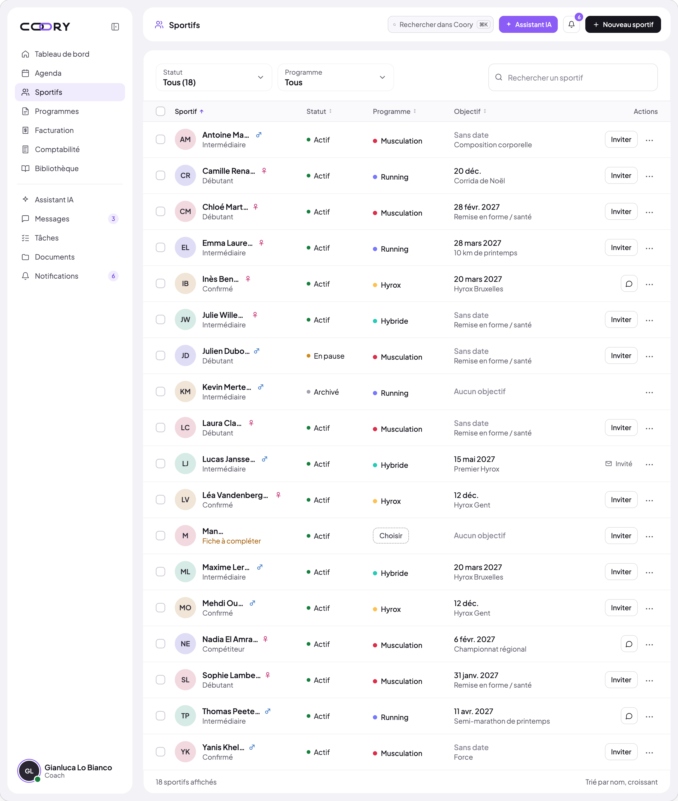

# 1a / 1b — Desktop (référence 1280 px)

Coque commune : voir [../../shared-components/navigation.md](../../shared-components/navigation.md) (sidebar, header, barre mobile)

## C. Dimensions et propriétés (exactes sauf mention « estimé »)
- Cadre : sidebar 236 + main (`gap:20px`), fond `#f3f2f7`.
- Grille du tableau (en-tête ET lignes, exact) : `grid-template-columns:20px minmax(0,1.7fr) minmax(0,.8fr) minmax(0,1fr) minmax(0,1.6fr) 150px; gap:16px; padding:10px 24px`.
- En-tête : fond `#faf9fc`, filets haut/bas 1 px `rgba(22,18,40,.07)`, `500 12.5px #64626e`. Flèche de tri active `#6a3ee0`.
- Ligne : `min-height:68px`, filet bas `rgba(22,18,40,.06)`, hover `#faf9fc`, ligne sélectionnée = fond violet très léger (`r.rowBg`, voir logique).
- Avatar 40 (estimé d’après capture), nom `600 14–15px` ellipse, niveau `400 13px #64626e`.
- Recherche : `400 14px`, champ contour .12 r12 (estimé h46).
- Menus Statut/Programme : liste `top:58px`, r14, `padding:6px`, ombre `0 14px 34px rgba(22,18,40,.16),0 0 0 1px rgba(22,18,40,.06)`, options avec compteur.
- Bouton « Inviter » contour .14 h38 r10 ; « ··· » 32 (estimé).

## D. Typographie spécifique
Voir design-system/typography.md. Titres de carte `600 17px`, sous-titres `400 13.5px/1.5 #64626e`, valeurs `400 15px`, métadonnées `400 12.5px #64626e`.

## H. Règles de redimensionnement desktop
- 1280 → 1920 : les colonnes en `fr`/`auto-fit` s’élargissent ; sidebar fixe 236.
- ≥ 2560 : contenu de la fiche plafonné à `max-width:1600px`, centré.
- Aucun débordement horizontal ; la barre d’onglets défile si nécessaire.
