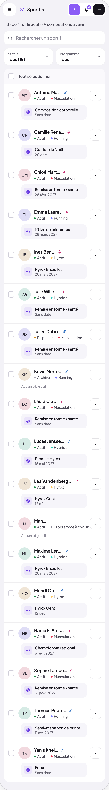

# 1a / 1b — Mobile (référence 390 px)

Coque commune : voir [../../shared-components/navigation.md](../../shared-components/navigation.md) (sidebar, header, barre mobile)

## Ordre exact des sections
1. Barre : hamburger · « Sportifs » · [IA · cloche (4) · +].
2. Résumé : « 18 sportifs · 16 actifs · 9 compétitions à venir » (`#64626e`).
3. Champ « Rechercher un sportif » pleine largeur (16 px).
4. Grille 2 colonnes `1fr 1fr` gap 10 : menus Statut / Programme (liste en `top:66px`).
5. Carte liste : ligne « Tout sélectionner » puis une **carte-ligne par sportif** : case · avatar · nom + ♀/♂ · ligne « ● Actif · ● Musculation » · bouton « ··· » carré à droite ; dessous, sous-carte objectif (icône cible violette + nom de l’objectif + date) ou « Aucun objectif ».
6. Barre de sélection mobile : Changer le statut · Changer le programme · Annuler.

## Règles
- Contenu : `padding:16px 14px 28px`, `gap:12px`, cartes pleine largeur.
- Inputs `16px` (pas de zoom iOS), cibles ≥ 40 px.
- Aucun scroll horizontal.
- Prévoir `env(safe-area-inset-bottom)` en bas de page (non dessiné).

