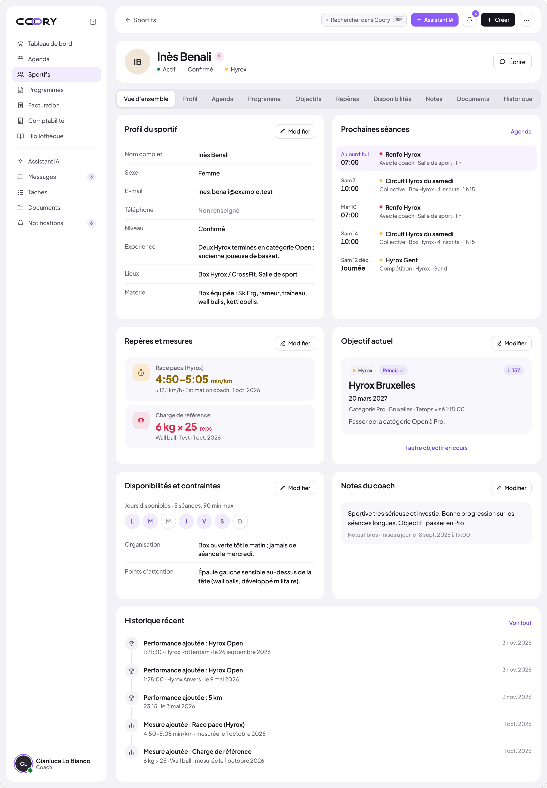

# 2a — Desktop (référence 1280 px)

Coque commune : voir [../../shared-components/navigation.md](../../shared-components/navigation.md) (sidebar, header, barre mobile)

En-tête de fiche + onglets : voir [../../shared-components/headers.md](../../shared-components/headers.md)

## C. Dimensions et propriétés (exactes sauf mention « estimé »)
- Cartes standard (r20, p22, gap16) ; boutons « Modifier » contour h34 `padding:0 12px` r10 `500 13px` + crayon 13.
- Lignes clé/valeur : 2 colonnes (libellé `400 13.5px #64626e` ~40 % / valeur `500 14px #17151d`), filet 1 px `rgba(22,18,40,.07)`, « Non renseigné » en `#8b8996` (estimé).
- Prochaines séances : grille `78px minmax(0,1fr)` gap 12, `padding:11px 12px`, r12 ; jour `500 12px #64626e`, heure `600 15px` tabulaire ; titre `600 14px` + point 7 ; méta `400 12.5px/1.45`.
- Repère : sous-carte `#f8f7fb` r14 `padding:16px 18px` gap 14 ; pastille 40 r12 (Hyrox `rgba(254,193,79,.24)` icône `#8a6200` ; Musculation `rgba(221,45,74,.10)` icône `#DD2D4A`) ; valeur `700 24px/1.1` couleur discipline + unité `600 13.5px`.
- Ronds de jours : ~36 px (estimé), disponibles fond violet clair texte `#6a3ee0`, indisponibles contour gris.
- Les deux cartes d’une même ligne ont la même hauteur (grille).

## D. Typographie spécifique
Voir design-system/typography.md. Titres de carte `600 17px`, sous-titres `400 13.5px/1.5 #64626e`, valeurs `400 15px`, métadonnées `400 12.5px #64626e`.

## H. Règles de redimensionnement desktop
- 1280 → 1920 : les colonnes en `fr`/`auto-fit` s’élargissent ; sidebar fixe 236.
- ≥ 2560 : contenu de la fiche plafonné à `max-width:1600px`, centré.
- Aucun débordement horizontal ; la barre d’onglets défile si nécessaire.
