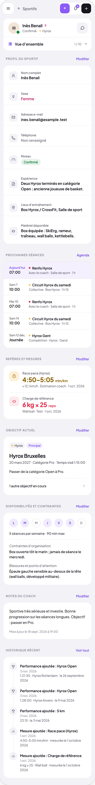

# 2a — Mobile (référence 390 px)

Coque commune : voir [../../shared-components/navigation.md](../../shared-components/navigation.md) (sidebar, header, barre mobile)

## Ordre exact des sections
1. Barre + carte identité + sélecteur d’onglet (« Vue d’ensemble 1 / 10 »).
2. Chaque carte devient : **titre de section en MAJUSCULES hors carte** (`#8b8996`) + lien « Modifier » violet à droite, puis la carte.
3. Ordre : PROFIL DU SPORTIF (lignes avec icône 32 ronde grise à gauche, libellé + valeur, Niveau en badge vert) → PROCHAINES SÉANCES → REPÈRES ET MESURES → OBJECTIF ACTUEL (« 1 autre objectif en cours › ») → DISPONIBILITÉS ET CONTRAINTES → NOTES DU COACH → HISTORIQUE RÉCENT (« Voir tout »).

## Règles
- Contenu : `padding:16px 14px 28px`, `gap:12px`, cartes pleine largeur.
- Inputs `16px` (pas de zoom iOS), cibles ≥ 40 px.
- Aucun scroll horizontal.
- Prévoir `env(safe-area-inset-bottom)` en bas de page (non dessiné).

