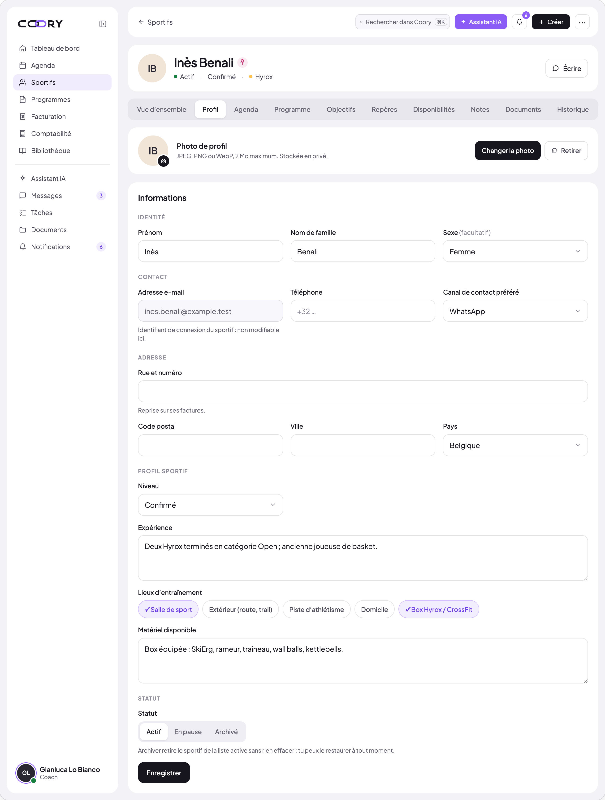

# 2b — Desktop (référence 1280 px)

Coque commune : voir [../../shared-components/navigation.md](../../shared-components/navigation.md) (sidebar, header, barre mobile)

En-tête de fiche + onglets : voir [../../shared-components/headers.md](../../shared-components/headers.md)

## C. Dimensions et propriétés (exactes sauf mention « estimé »)
- Carte photo : `padding:18px 22px`, flex-wrap, `gap:14px 18px`, centré ; avatar 64 `#f0e5d6` `600 20px` ; pastille 24 `#17151d` + `0 0 0 2.5px #fff` en bas à droite ; bloc texte `flex:1 1 180px` (`600 15px` / `400 12.5px/1.45 #64626e`) ; boutons h40 r10.
- Grille de champs : 3 colonnes à 1280 (`auto-fit minmax(240px)`), gap 16 ; Rue pleine largeur ; textareas pleine largeur.
- Pastilles lieux : sélectionnées fond `rgba(139,92,246,.10)` + texte `#6a3ee0` + « ✓ » + anneau violet ; non sélectionnées contour .14 (estimé h40 r20 d’après capture).
- Champ e-mail verrouillé : fond `#f3f2f7`-like, texte `#64626e`.

## D. Typographie spécifique
Voir design-system/typography.md. Titres de carte `600 17px`, sous-titres `400 13.5px/1.5 #64626e`, valeurs `400 15px`, métadonnées `400 12.5px #64626e`.

## H. Règles de redimensionnement desktop
- 1280 → 1920 : les colonnes en `fr`/`auto-fit` s’élargissent ; sidebar fixe 236.
- ≥ 2560 : contenu de la fiche plafonné à `max-width:1600px`, centré.
- Aucun débordement horizontal ; la barre d’onglets défile si nécessaire.
