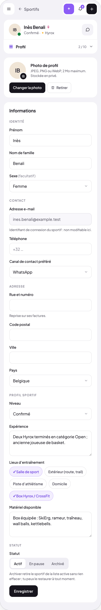

# 2b — Mobile (référence 390 px)

Coque commune : voir [../../shared-components/navigation.md](../../shared-components/navigation.md) (sidebar, header, barre mobile)

## Ordre exact des sections
1. Barre + identité + sélecteur « Profil 2 / 10 ».
2. Carte photo : avatar + texte sur une ligne, **les deux boutons passent dessous**.
3. Carte Informations en une colonne (Prénom/Nom/… empilés), pastilles en retour à la ligne, segmenté statut, Enregistrer.

## Règles
- Contenu : `padding:16px 14px 28px`, `gap:12px`, cartes pleine largeur.
- Inputs `16px` (pas de zoom iOS), cibles ≥ 40 px.
- Aucun scroll horizontal.
- Prévoir `env(safe-area-inset-bottom)` en bas de page (non dessiné).

