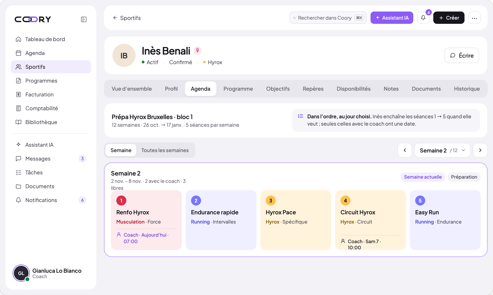

# 2c — Desktop (référence 1280 px)

Coque commune : voir [../../shared-components/navigation.md](../../shared-components/navigation.md) (sidebar, header, barre mobile)

En-tête de fiche + onglets : voir [../../shared-components/headers.md](../../shared-components/headers.md)

## C. Dimensions et propriétés (exactes sauf mention « estimé »)
- Cartes de séance : 5 colonnes égales (gap 16 estimé), r16, fond teinté discipline (Musculation `rgba(221,45,74,.08)`, Running `rgba(119,118,255,.10)`, Hyrox `rgba(254,193,79,.16)`), numéro rond 28 couleur pleine texte blanc (Hyrox : texte foncé).
- Semaine actuelle : anneau `rgba(139,92,246,.55)`-like 1.5 px, r20.
- ⚠️ Capture : le sous-titre « … · 3 libres » passe à la ligne et la carte 4 est rognée en bas — **défaut de la maquette, ne pas reproduire** : sous-titre sur une ligne (`nowrap` ou largeur suffisante), cartes à hauteur de contenu.

## D. Typographie spécifique
Voir design-system/typography.md. Titres de carte `600 17px`, sous-titres `400 13.5px/1.5 #64626e`, valeurs `400 15px`, métadonnées `400 12.5px #64626e`.

## H. Règles de redimensionnement desktop
- 1280 → 1920 : les colonnes en `fr`/`auto-fit` s’élargissent ; sidebar fixe 236.
- ≥ 2560 : contenu de la fiche plafonné à `max-width:1600px`, centré.
- Aucun débordement horizontal ; la barre d’onglets défile si nécessaire.
