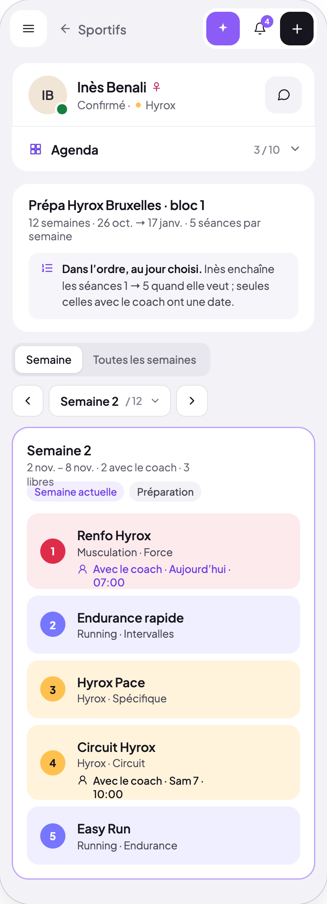

# 2c — Mobile (référence 390 px)

Coque commune : voir [../../shared-components/navigation.md](../../shared-components/navigation.md) (sidebar, header, barre mobile)

## Ordre exact des sections
1. Barre + identité + sélecteur « Agenda 3 / 10 ».
2. Carte programme (encadré info sous le titre).
3. Segmenté pleine largeur ; navigation semaine.
4. Carte semaine : séances **empilées verticalement** (une par ligne).

## Règles
- Contenu : `padding:16px 14px 28px`, `gap:12px`, cartes pleine largeur.
- Inputs `16px` (pas de zoom iOS), cibles ≥ 40 px.
- Aucun scroll horizontal sauf : aucun.
- Prévoir `env(safe-area-inset-bottom)` en bas de page (non dessiné).

