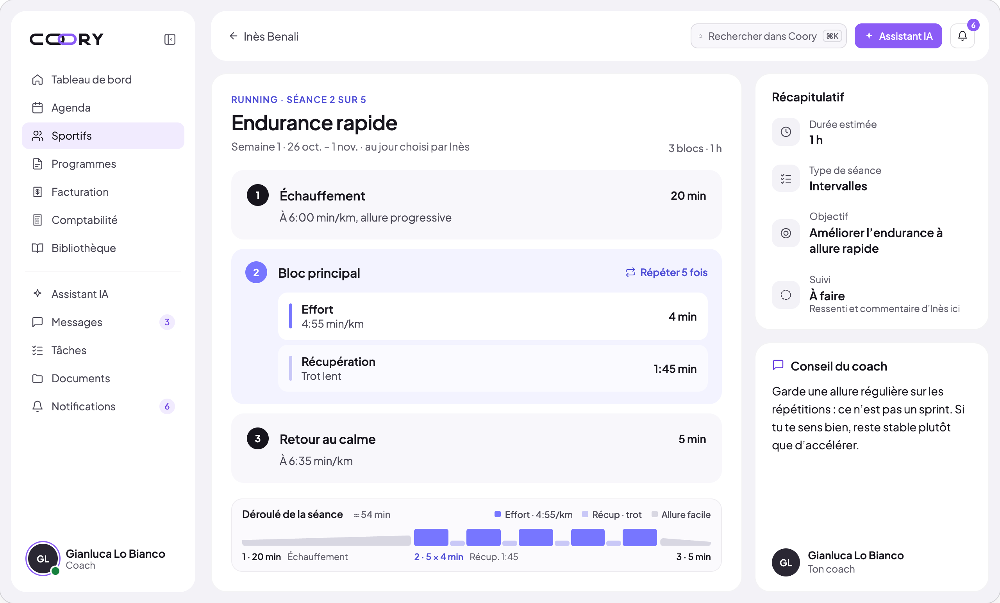

# 2d — Desktop (référence 1280 px)

Coque commune : voir [../../shared-components/navigation.md](../../shared-components/navigation.md) (sidebar, header, barre mobile)

## C. Dimensions et propriétés (exactes sauf mention « estimé »)
- Libellés du récapitulatif `400 12.5px/1.4 #64626e` **nowrap**.
- Profil d’intensité : couleurs Effort `#7776FF`, Récup `#c9c8f7`, facile `#d8d7e2` ; barres r3–4 ; largeur de chaque groupe proportionnelle à la durée (20 / 28.75 / 6).
- Alignement bas : le conteneur de la séance remplit `main` (`flex:1`, grille `grid-template-rows:minmax(0,1fr)`).

## D. Typographie spécifique
Voir design-system/typography.md. Titres de carte `600 17px`, sous-titres `400 13.5px/1.5 #64626e`, valeurs `400 15px`, métadonnées `400 12.5px #64626e`.

## H. Règles de redimensionnement desktop
- 1280 → 1920 : les colonnes en `fr`/`auto-fit` s’élargissent ; sidebar fixe 236.
- ≥ 2560 : contenu de la fiche plafonné à `max-width:1600px`, centré.
- Aucun débordement horizontal ; la barre d’onglets défile si nécessaire.
