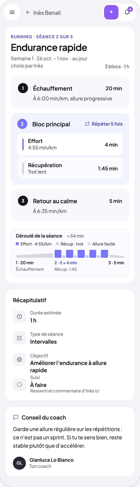

# 2d — Mobile (référence 390 px)

Coque commune : voir [../../shared-components/navigation.md](../../shared-components/navigation.md) (sidebar, header, barre mobile)

## Ordre exact des sections
Une colonne, **dans cet ordre** : carte Séance (étapes puis déroulé, sous-lignes non indentées, libellés du déroulé sur 2 lignes « 1 · 20 min » / « Échauffement ») → Récapitulatif → Conseil du coach.

## Règles
- Contenu : `padding:16px 14px 28px`, `gap:12px`, cartes pleine largeur.
- Inputs `16px` (pas de zoom iOS), cibles ≥ 40 px.
- Aucun scroll horizontal.
- Prévoir `env(safe-area-inset-bottom)` en bas de page (non dessiné).

