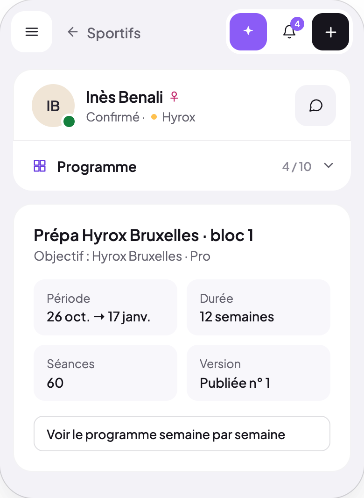

# 2e — Mobile (référence 390 px)

Coque commune : voir [../../shared-components/navigation.md](../../shared-components/navigation.md) (sidebar, header, barre mobile)

## Ordre exact des sections
1. Barre supérieure + carte identité + sélecteur d’onglet (« Programme n / 10 »).
2. Carte unique, valeurs en grille auto-fit, bouton pleine largeur.

## Règles
- Contenu : `padding:16px 14px 28px`, `gap:12px`, cartes pleine largeur.
- Inputs `16px`, cibles ≥ 40 px, aucun scroll horizontal.
- Prévoir `env(safe-area-inset-bottom)` (non dessiné).
