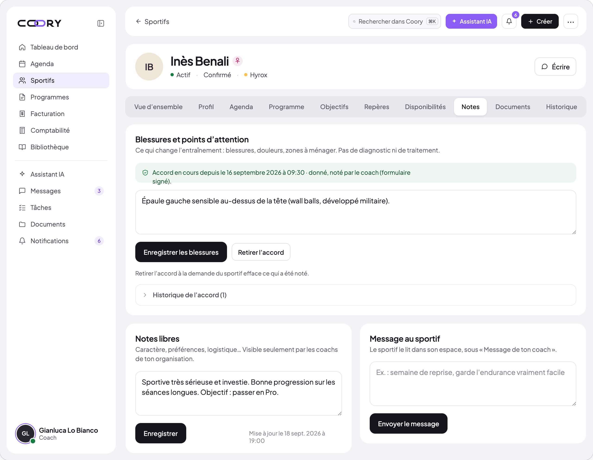

# 2i — Desktop (référence 1280 px)

Coque commune : voir [../../shared-components/navigation.md](../../shared-components/navigation.md) (sidebar, header, barre mobile)

En-tête de fiche + onglets : voir [../../shared-components/headers.md](../../shared-components/headers.md)

## C. Dimensions et propriétés (exactes sauf mention « estimé »)
- Cartes standard : `#fff`, rayon 20, `inset 0 0 0 1px rgba(22,18,40,.05)`, padding 22, `gap:16px`.
- Bandeau : fond `rgba(21,128,61,.07)`, texte `#15803d` ; ⚠️ la capture montre un retour à la ligne serré : prévoir padding vertical + `line-height:1.45`.

## D. Typographie spécifique
Voir design-system/typography.md. Titres de carte `600 17px`, sous-titres `400 13.5px/1.5 #64626e`, libellés `500 13.5px`, valeurs `400 15px`, métadonnées `400 12.5px #64626e`.

## H. Règles de redimensionnement desktop
- 1280 → 1920 : grilles `auto-fit` / `fr` s’élargissent ; sidebar fixe 236.
- ≥ 2560 : fiche plafonnée à `max-width:1600px`, centrée.
- Aucun débordement horizontal ; barre d’onglets défilante si nécessaire.
