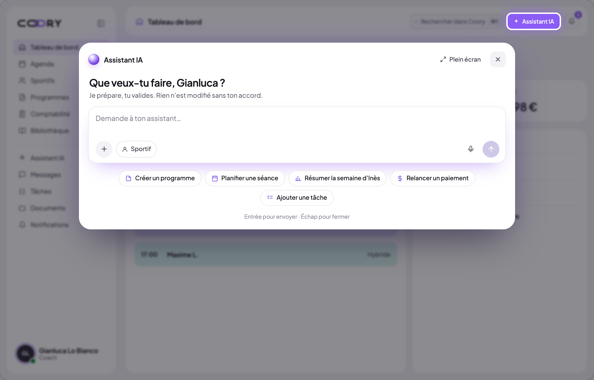

# Boîte de dialogue Assistant IA

| Champ | Valeur |
|---|---|
| Identifiant | `m02a-assistant-dialogue` |
| Page | [02](../../pages/) |
| Desktop | ✅ |
| Mobile | ✅ |
| Composant DS | voir `../../design-system/modals.md` |

