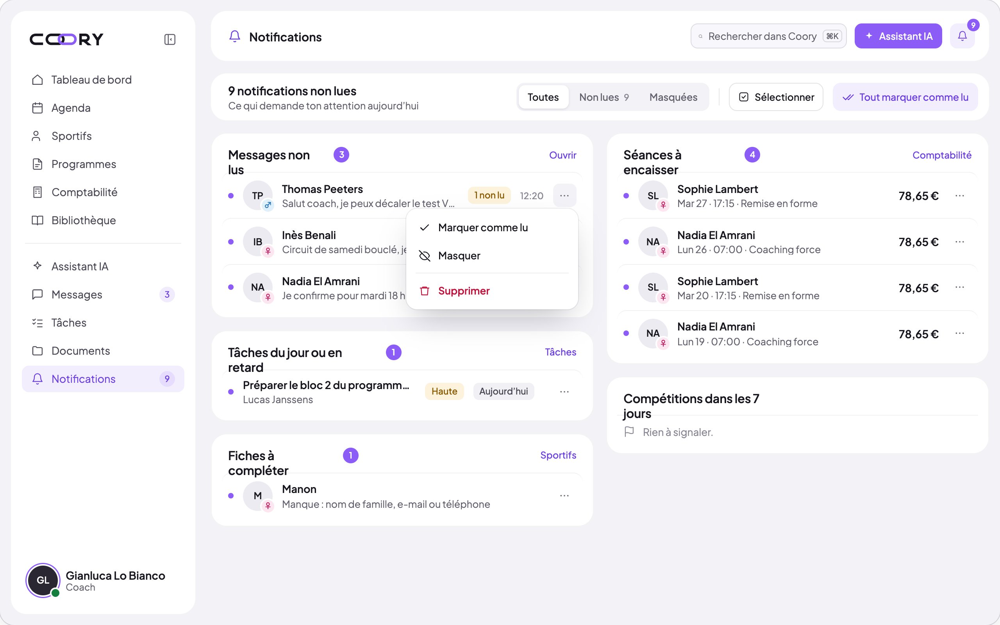

# Menu « … » d’une notification

| Champ | Valeur |
|---|---|
| Identifiant | `m03a-menu-actions-notification` |
| Page | [03](../../pages/) |
| Desktop | ✅ |
| Mobile | ✅ |
| Composant DS | voir `../../design-system/modals.md` |

