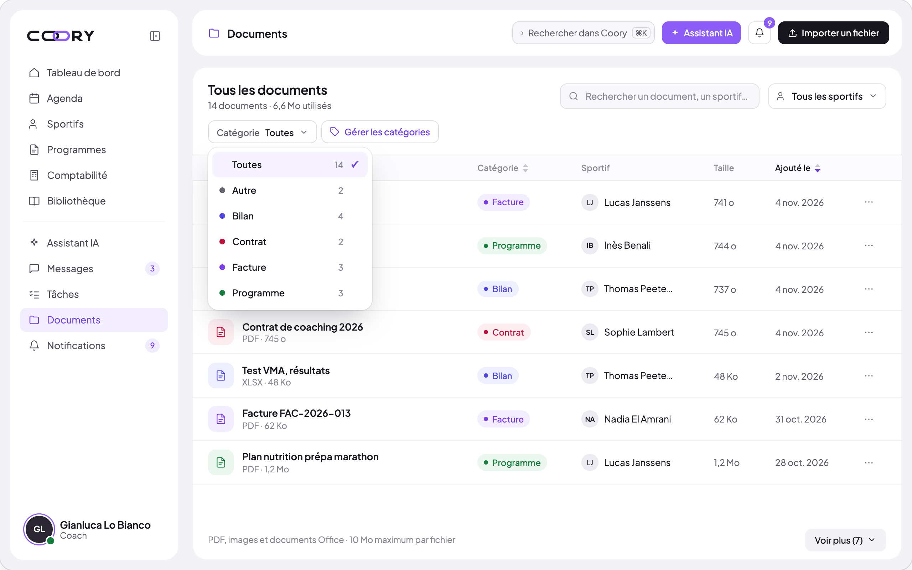

# Menu déroulant « Catégorie »

| Champ | Valeur |
|---|---|
| Identifiant | `m05a-menu-categorie` |
| Page | [05](../../pages/) |
| Desktop | ✅ |
| Mobile | ✅ |
| Composant DS | voir `../../design-system/modals.md` |

