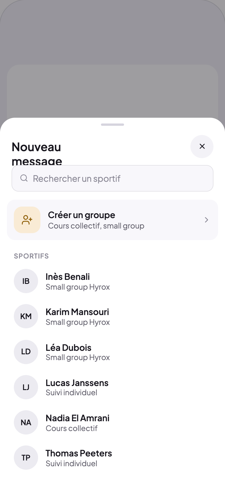

# Nouveau message (mobile)

| Champ | Valeur |
|---|---|
| Identifiant | `m07b-nouveau-message` |
| Page | [07](../../pages/) |
| Desktop | — |
| Mobile | ✅ |
| Composant DS | voir `../../design-system/modals.md` |

