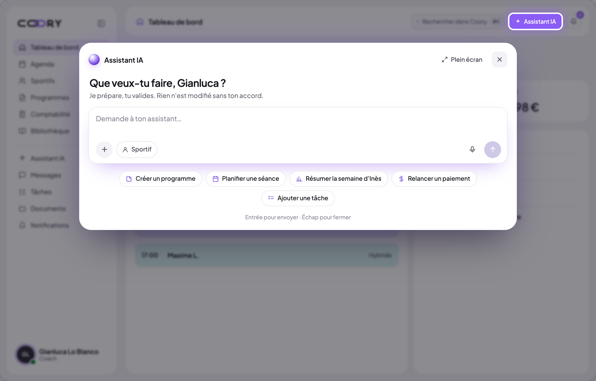

# 02 · Assistant IA — spécification desktop (1280 px)

## Architecture desktop
### A. Boîte de dialogue (1a) — ouverte depuis le bouton « Assistant IA » du header
- Overlay `rgba(14,12,22,.48)` + `backdrop-filter:blur(2px)` sur la page (ici le tableau de bord).
- Boîte `position:absolute; left:170px; right:170px; top:92px; max-height:660px; border-radius:26px; background:#fff` (`role=dialog`).
- Ligne haute : orbe 24 px + titre, **« Plein écran »** (→ page complète) et **« Fermer »** (icônes 40×40 `#f3f2f7`).
- État vide : « Que veux-tu faire, Gianluca ? » `600 22px` + zone de saisie + **suggestions** en pilules centrées (5).
- Conversation : messages (max-height 330 px, défilant) — bulle utilisateur `#17151d` alignée à droite `border-radius:16px 16px 4px 16px` ; réponse de l’assistant avec orbe + texte + **card « ACTIONS PROPOSÉES »** (cases cochées par défaut, bouton violet « Valider N actions », aide « Coche ce que tu gardes »).
- Zone de saisie : `border-radius:18px`, ombre violette ; textarea « Demande à ton assistant… » (2 lignes) ; rangée : Joindre (36 rond `#f3f2f7`) · pilule contexte **« Sportif »** (devient « Inès Benali » une fois choisi) · espace · Dicter · Envoyer (36 rond violet, grisé si vide).
### B. Page complète (1c)
- Shell : entrée « Assistant IA » active ; header « ✦ Assistant IA ».
- Card `flex:1; border-radius:20px; display:flex; overflow:hidden` :
  - **Colonne Historique** `width:250px; border-right` : bouton **« ✎ Nouvelle conversation »** (`height:40px; #17151d; radius 11`) puis groupes datés « AUJOURD’HUI », « CETTE SEMAINE » (`600 12px; .04em; #8b8996`) et titres de conversations (`400 14px`, une ligne + ellipsis).
  - **Zone de conversation** `flex:1; padding:0 40px 28px` : état vide = orbe 72 px, « Bonjour Gianluca. Comment puis-je t’aider ? » `700 32px/1.2`, sous-titre, zone de saisie 3 lignes, **3 cards de raccourcis** (Programmer · Analyser · Administratif, grille 3 colonnes `gap:12px`) ; état conversation = fil centré `max-width:720px` + saisie « Répondre… » en bas.

> Valeurs non citées ici : voir `layout-measurements.md` (exactes). Shell : `../../global-shell/`.
