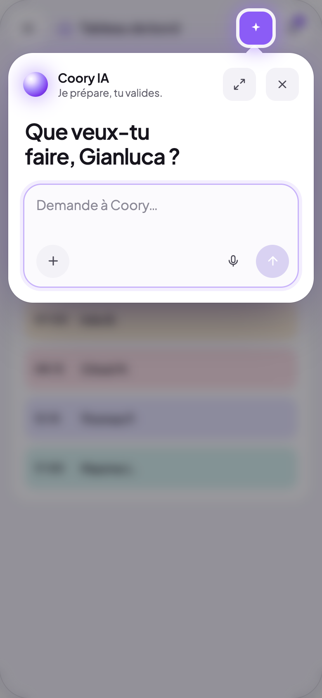
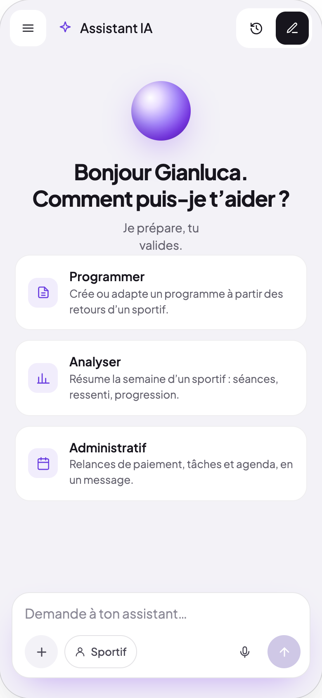
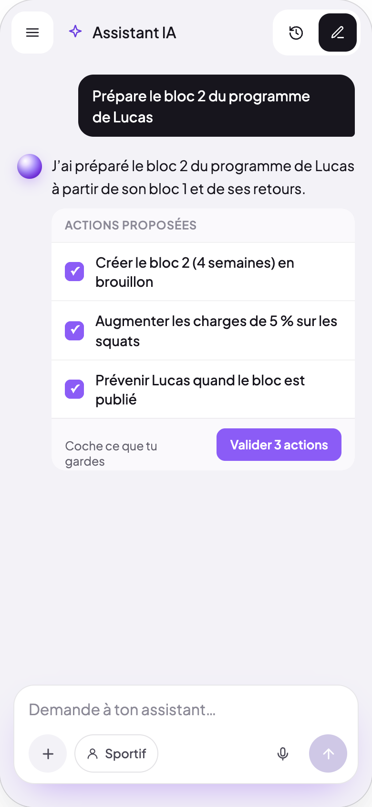

# 02 · Assistant IA — spécification mobile (390 px)

## Architecture mobile
### A. Boîte de dialogue (1b)
- SH-05 visible ; boîte ancrée `left/right:10px; top:64px; max-height:740px; border-radius:30px` avec **flèche** (carré 16 px tourné 45°) pointant vers le bouton ✦ (`right:64px`).
- Ligne haute : orbe 30 px · titre · **Plein écran** · **Fermer** (40×40).
- Accueil « Que veux-tu faire, Gianluca ? » `600 26px/1.15` ; raccourcis ; saisie « Demande à Coory… » dans un cadre violet (`inset 0 0 0 1.5px rgba(139,92,246,.45)` + halo 4 px) ; bouton **« + Plus d’options »** (40 rond) qui ouvre un menu (Joindre un fichier + suggestions) ; Dicter ; Envoyer.
### B. Page complète (1d) — EX-01
- En-tête propre : ☰ · « ✦ Assistant IA » · groupe blanc **[Historique ⟲] [Nouvelle conversation ✎ (fond #17151d)]**.
- État vide : orbe 72 px + accueil + raccourcis ; conversation : bulles pleine largeur, card d’actions proposées.
- **Saisie fixée en bas** (card blanche `border-radius` ~20 px, halo violet) : textarea, + · Sportif · Dicter · Envoyer. Reste collée au clavier virtuel.
- ⚠️ **Historique mobile : le bouton existe mais le panneau n’est pas dessiné** → voir `features/assistant-ai-chat-history.md` (À COMPLÉTER).

> Barre d’état « 9:41 » éventuelle = présentation, ne pas implémenter. En-tête : appliquer `../../global-shell/mobile-layout.md` et `contextual-navigation.md`.
