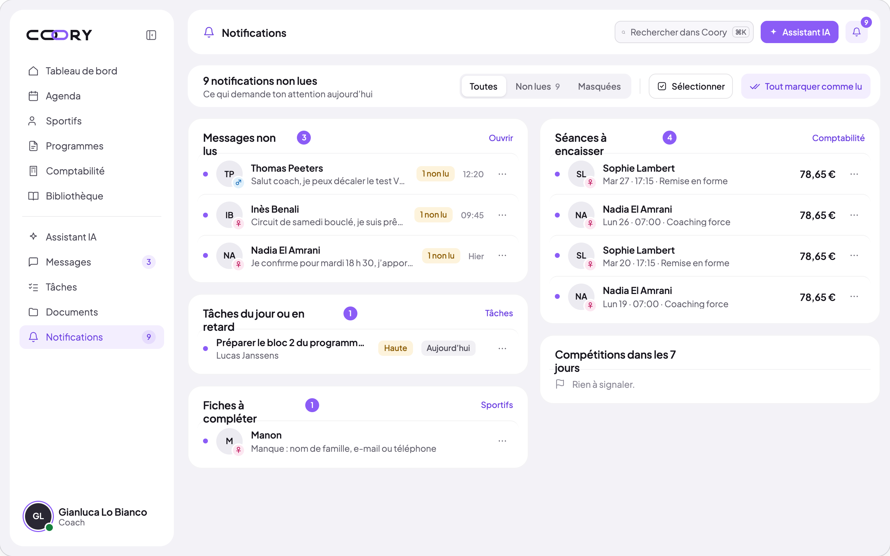

# 03 · Notifications — spécification desktop (1280 px)

## Architecture desktop
1. Shell : « Notifications » actif ; header « 🔔 Notifications » (**« Tout marquer comme lu » n’est plus dans le header**).
2. **Barre d’outils** (card blanche pleine largeur) : onglets segmentés **Toutes · Non lues (9) · Masquées** à gauche ; à droite **« Sélectionner »** et **« ✓✓ Tout marquer comme lu »** (bouton secondaire, grisé si tout est lu).
   - En mode sélection, la barre devient : case « Tout sélectionner » · **Marquer comme lu** · **Masquer** (`#f3f2f7`) · **Supprimer** (`#fdeef1`, texte rouge `600`) · « Annuler » (`height:36px; radius:10px; font:500 12.5px`).
3. **Grille 2 colonnes** de cards de section (`gap:16px`) :
   - Gauche : Messages non lus (3) · Tâches du jour ou en retard (1) · Fiches à compléter (1)
   - Droite : Séances à encaisser (4) · Compétitions dans les 7 jours (« Rien à signaler. »)
   - En-tête de card : titre `600 16px` + pastille de compteur violette pleine + lien de section (« Ouvrir », « Tâches », « Comptabilité », « Sportifs »).
   - Ligne : (case en mode sélection) · point violet = non lu · avatar 40 + pastille de genre · nom `600` + aperçu (ellipsis) · badge (« 1 non lu », « Haute », « Aujourd’hui ») ou montant · heure · menu **« … »**.
4. **Menu « … »** (M-MENU, items 36 px) : Marquer comme lu / non lu · Masquer (ou « Afficher à nouveau » dans Masquées) · séparateur · **Supprimer** en rouge.

> Valeurs non citées ici : voir `layout-measurements.md` (exactes). Shell : `../../global-shell/`.
