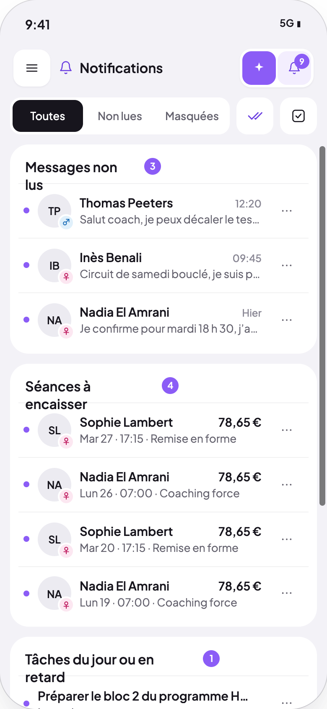

# 03 · Notifications — spécification mobile (390 px)

## Architecture mobile
- En-tête : ☰/← · « Notifications » · **icône ✓✓** (Tout marquer comme lu) à côté des onglets.
- Onglets segmentés pleine largeur ; sections en cards empilées (mêmes contenus) ; menu « … » en items de 46 px.
- **Mode sélection** : cases à cocher + **barre d’actions noire fixée en bas** (`#17151d`) avec 3 boutons de 52 px : Lu · Masquer · Supprimer (`#be123c`).
- **Toast** `bottom:28px; height:54px; radius:16px; #17151d` avec « Annuler » (5 s) après Masquer / Supprimer / Tout marquer comme lu.

> Barre d’état « 9:41 » éventuelle = présentation, ne pas implémenter. En-tête : appliquer `../../global-shell/mobile-layout.md` et `contextual-navigation.md`.
