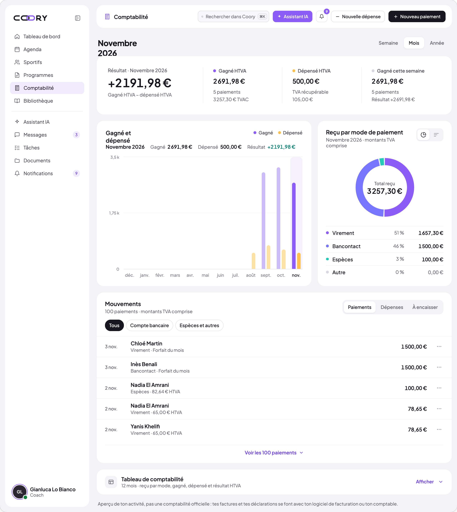

# 04 · Comptabilité — spécification desktop (1280 px)

## Architecture desktop (page longue, sidebar sticky)
1. Shell : « Comptabilité » actif (**« Facturation » retirée du menu**).
2. **Sélecteur de période** segmenté Semaine · Mois · Année (`role=tablist`).
3. **Card héro** : résultat de la période (`+2 191,98 €` ; rouge si négatif) + 2 tuiles « Gagné HTVA » (point violet) / « Dépensé HTVA » (point jaune) avec 2 lignes de détail (nb paiements, montant TVAC / TVA récupérable) + tuile « Gagné cette semaine ».
4. **Graphique mensuel** 12 barres doubles (gagné `#8b5cf6` / dépensé `#FEC14F`), axe Y 0 · 1,5 k · 3 k ; **barres cliquables** = sélection du mois (passe en période « Mois ») ; mois actif fond `#f5f2fe`, autres barres pâles (`#cbbcf7` / `#fde2a6`). Légende de résumé « Novembre 2026 · Gagné · Dépensé · Résultat ».
5. **Répartition par mode de paiement** avec bascule **graphique circulaire / graphique en barre** (2 boutons icône) : anneau (rayon 72) Virement `#8b5cf6` · Bancontact `#7776FF` · Espèces `#26CBB8` · Autre `#d9d7e2`, total TVAC au centre ; lignes avec barre de proportion, %, montant.
6. **Mouvements** : onglets Paiements · Dépenses · À encaisser ; filtres pilules (Paiements seulement) Tous · Compte bancaire · Espèces et autres ; lignes (date, nom, mode · détail, montant, menu « … ») ; 5 lignes puis **« Voir les 100 paiements » / « Afficher moins »** (chevron qui pivote).
7. **Tableau de comptabilité 12 mois** repliable (« Afficher / Masquer », `aria-expanded`) : colonnes Mois · Virement · Bancontact · Espèces · Gagné · Dépensé · Résultat ; mois sans activité masqués avec lien « Afficher les N mois sans activité » ; ligne de total ; mois sélectionné surligné.

> Valeurs non citées ici : voir `layout-measurements.md` (exactes). Shell : `../../global-shell/`.
