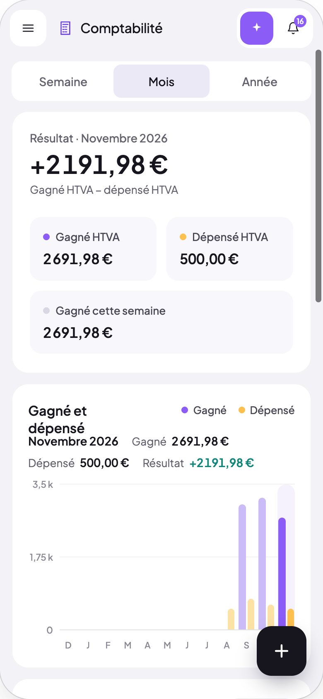
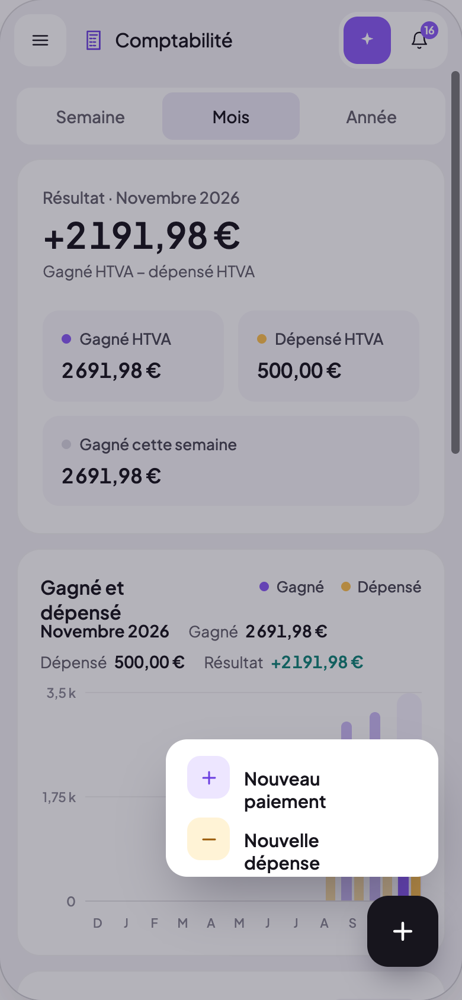

# 04 · Comptabilité — spécification mobile (390 px)

## Architecture mobile
- SH-05 canonique (☰ · Comptabilité · ✦ 🔔) — **référence du shell mobile**.
- Zone défilante `padding:16px 14px 110px; gap:12px` : sélecteur de période pleine largeur (segments 40 px) → card résultat + tuiles en grille (la tuile « cette semaine » sur toute la largeur) → graphique (barres 3 px de gap, initiales des mois) → répartition → mouvements → tableau.
- **FAB +** (SH-08) → menu ancré en bas à droite : **Nouveau paiement** (« Un sportif t’a payé », icône + violette) · **Nouvelle dépense** (« Salle, matériel, abonnement… », icône − jaune) ; le + pivote en × ; overlay `rgba(22,18,40,.32)`.

> Barre d’état « 9:41 » éventuelle = présentation, ne pas implémenter. En-tête : appliquer `../../global-shell/mobile-layout.md` et `contextual-navigation.md`.
