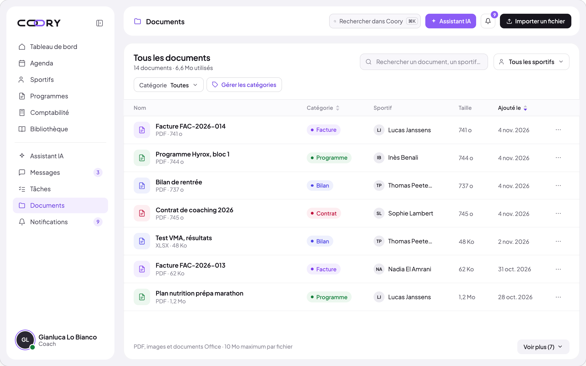

# 05 · Documents — spécification desktop (1280 px)

## Architecture desktop
1. Shell : « Documents » actif ; header « Documents » + sous-titre **« N documents · X utilisés »** (remplace les 4 cards de stats supprimées) + bouton **Importer**.
2. Barre : recherche + **menu déroulant « Catégorie · Toutes ▾ »** (pastille couleur, nombre de documents par catégorie, coche sur l’actif) + lien **« Gérer les catégories »** juste à côté. Les filtres rapides (Ajoutés ce mois-ci / Liés à un sportif / Sans sportif) sont **supprimés**.
3. Card « Tous les documents » (alignée sur le bas du panneau de gauche) : **tableau** Nom (icône type + nom, ellipsis) · Catégorie · Sportif · Taille · Ajouté le · actions ; **tri par flèches** sur Catégorie (A→Z / Z→A) et Ajouté le (récent → ancien par défaut).
4. 7 lignes puis **« Voir plus (7) » / « Réduire »** : bouton gris en bas à droite de la card.

> Valeurs non citées ici : voir `layout-measurements.md` (exactes). Shell : `../../global-shell/`.
