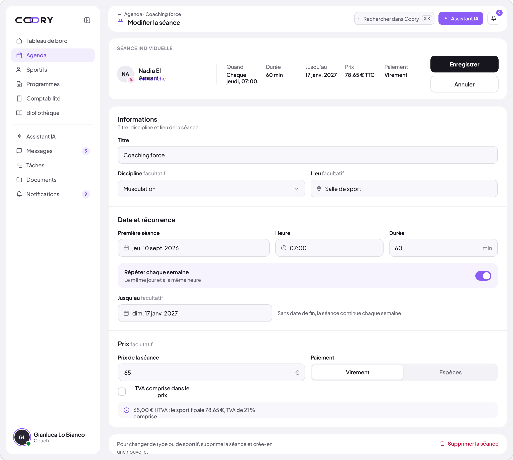

# 06 · Modifier la séance (individuelle) — spécification desktop (1280 px)

## Architecture desktop — **cards empilées pleine largeur** (règle du 4 nov. 2026)
1. Shell : « Agenda » actif ; header : « ← Agenda · Coaching force » / « 📅 Modifier la séance ».
2. **C-RECAP (au-dessus)** `grid-template-columns:220px minmax(0,1fr) 170px; padding:18px 22px` : libellé « SÉANCE INDIVIDUELLE » (pleine ligne) · sportif (avatar 42 + pastille de genre, nom, « Voir la fiche ») · récap live en 5 colonnes séparées par un `border-left` (Quand · Durée · Jusqu’au · Prix · Paiement) · boutons empilés **Enregistrer** (`#17151d`, 42 px) / **Annuler**.
3. **C-FORM** en 3 sections : **Informations** (Titre ; Discipline ▾ facultatif · Lieu facultatif avec icône pin) · **Date et récurrence** (Première séance · Heure · Durée « min » en grille `1.4fr 1fr 1fr` ; **interrupteur « Répéter chaque semaine »** ligne entière, fond `rgba(139,92,246,.08)` si actif ; si actif : « Jusqu’au » facultatif + aide « Sans date de fin, la séance continue chaque semaine. ») · **Prix** facultatif (Prix de la séance « € » · **Paiement segmenté Virement · Espèces** ; case « TVA comprise dans le prix » ; **ligne de calcul live**).
4. **C-FOOT (en dessous)** : « Pour changer de type ou de sportif, supprime la séance et crée-en une nouvelle. » à gauche · **« 🗑 Supprimer la séance »** rouge à droite.

> Valeurs non citées ici : voir `layout-measurements.md` (exactes). Shell : `../../global-shell/`.
