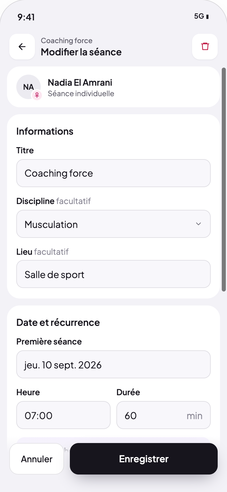

# 06 · Modifier la séance (individuelle) — spécification mobile (390 px)

## Architecture mobile
- En-tête **SH-05** : ☰ · « ← Agenda » (ou l’écran d’origine) · ✦ 🔔 — l’en-tête « ← Titre » de la maquette n’est pas reproduit (décision du 4 nov.).
- Titre « Modifier la séance » en tête du contenu, **corbeille rouge** 44×44 à sa droite.
- Card sportif · card Informations · card Date et récurrence · card Prix · texte d’avertissement.
- **Barre fixe** Annuler / Enregistrer (`54px`).

> Barre d’état « 9:41 » éventuelle = présentation, ne pas implémenter. En-tête : appliquer `../../global-shell/mobile-layout.md` et `contextual-navigation.md`.
