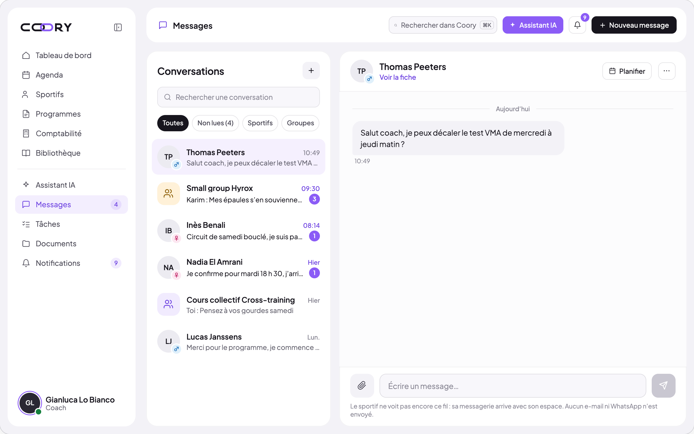

# 07 · Messages — spécification desktop (1280 px)

## Architecture desktop
1. Shell : « Messages » actif ; header « Messages » + **bouton « Nouveau message »**.
2. Card 2 colonnes (`340px 1fr`) :
   - **Liste** : titre « Conversations » + **petit « + »** (menu : Nouvelle conversation · Nouveau groupe) ; recherche ; filtres pilules **Toutes · Non lues (4) · Sportifs · Groupes** ; lignes (avatar rond pour un sportif, **carré coloré à icône groupe** pour un groupe, nom, aperçu, heure, compteur non lu).
   - **Fil** : en-tête (avatar, nom, sous-titre ; groupe : « N membres · Voir les membres ») + **« Planifier »** (individuel) ou **« Voir la séance »** (groupe) + menu « … » ; **bandeau prochaine séance** dans un groupe (date, lieu, inscrits) ; bulles (groupe : nom de l’expéditeur au-dessus) ; note « Tous les membres du groupe voient ce message. » ; **composer** : trombone · champ · Envoyer (grisé si vide, Entrée envoie).
3. **Modale « Nouveau groupe »** (2a, voir `../../modals-and-panels/m07a-nouveau-groupe/`).

> Valeurs non citées ici : voir `layout-measurements.md` (exactes). Shell : `../../global-shell/`.
