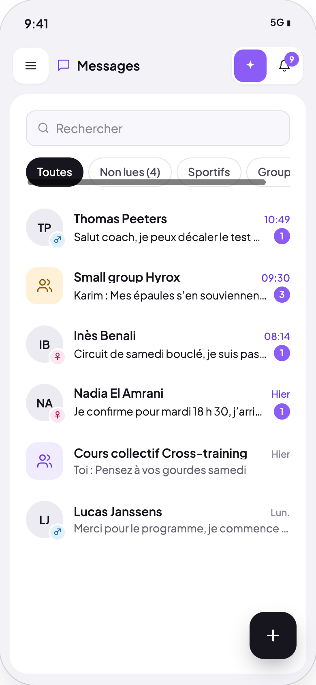
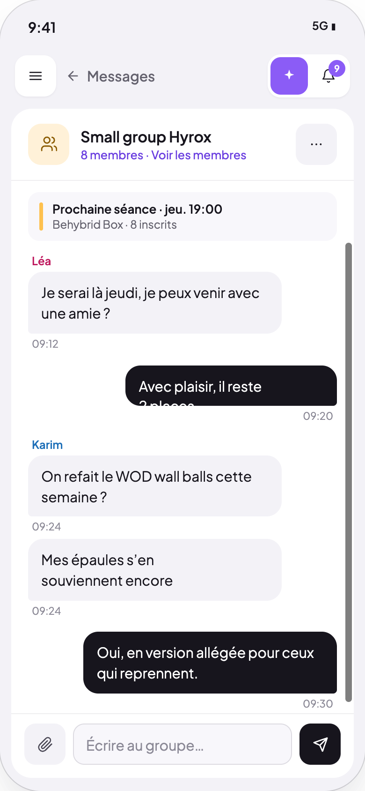

# 07 · Messages — spécification mobile (390 px)

## Architecture mobile
- **1b Conversations** : SH-05, recherche, filtres, liste ; **FAB +** → feuille « Nouveau message » (2b).
- **1c Conversation de groupe** : en-tête ← + avatar groupe + nom + membres ; bandeau séance ; bulles ; composer fixé en bas (EX-06).
- **2b Nouveau message** : feuille avec recherche de sportif, « Créer un groupe » en tête, liste des sportifs.
- **2c Nouveau groupe** : feuille 780 px (nom, séance liée facultative, membres à cocher, « Créer le groupe (N) »).

> Barre d’état « 9:41 » éventuelle = présentation, ne pas implémenter. En-tête : appliquer `../../global-shell/mobile-layout.md` et `contextual-navigation.md`.
