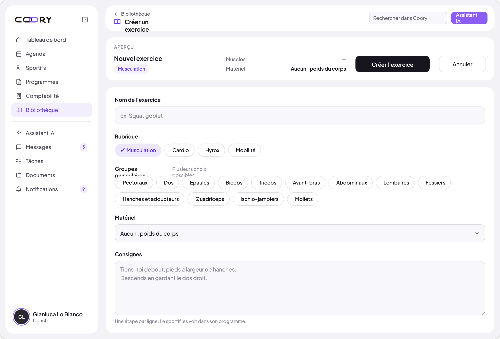

# 08 · Créer un exercice / Créer ma variante — spécification desktop (1280 px)

## Architecture desktop — cards empilées pleine largeur
1. Shell : « Bibliothèque » actif ; header : « ← Bibliothèque » (variante : « ← Bibliothèque · Sled push ») / « 📖 Créer un exercice » ou « Créer ma variante ».
2. **Card APERÇU (au-dessus)** `grid-template-columns:minmax(0,1fr) minmax(0,1.4fr) 190px 120px; padding:18px 22px` : libellé « APERÇU » · nom (`600 16px`, « Nouvel exercice » si vide) + pastille de rubrique `#f5f2fe/#6a3ee0` · détails (Muscles · Matériel) séparés par `border-left` · **« Créer l’exercice »** / **« Enregistrer ma variante »** (`#17151d`, 42 px) · **Annuler**.
3. **Card formulaire** `padding:24px; gap:22px` :
   - (variante) **bandeau C-INFO** : « Variante de « Sled push ». L’exercice d’origine reste inchangé. » + lien « Voir l’original ».
   - Nom de l’exercice (placeholder « Ex. Squat goblet »).
   - Rubrique : pilules **à choix unique** Musculation · Cardio · Hyrox · Mobilité.
   - Groupes musculaires : 13 pilules **à choix multiple** + compteur « N sélectionnés » / « Plusieurs choix possibles ».
   - Matériel ▾ (défaut « Aucun : poids du corps »).
   - Consignes (textarea 140 px) + aide « Une étape par ligne. Le sportif les voit dans son programme. »

> Valeurs non citées ici : voir `layout-measurements.md` (exactes). Shell : `../../global-shell/`.
