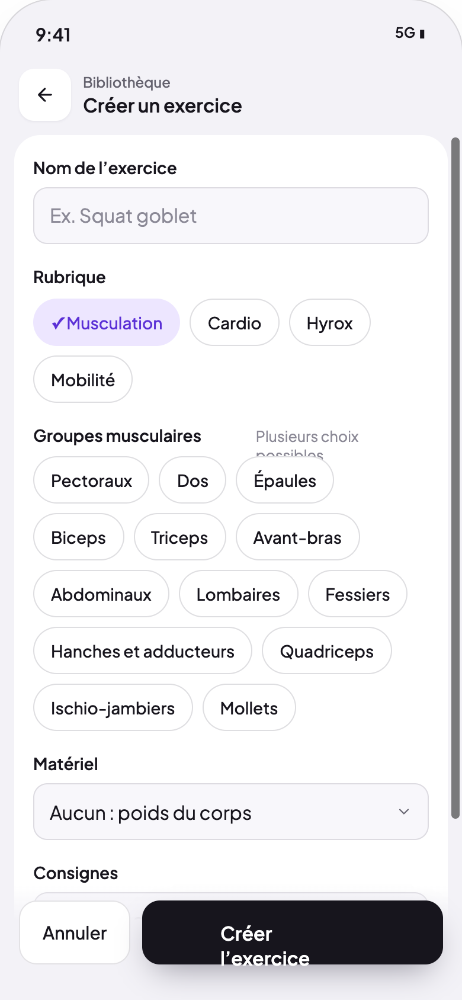
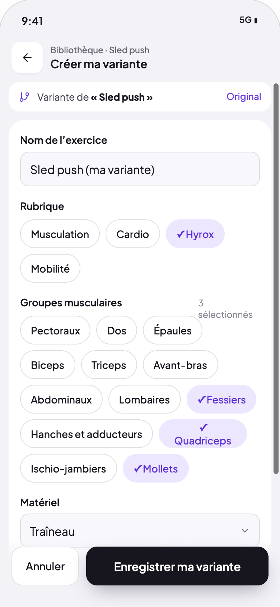

# 08 · Créer un exercice / Créer ma variante — spécification mobile (390 px)

## Architecture mobile
- En-tête **SH-05** : ☰ · « ← Bibliothèque » (ou l’écran d’origine) · ✦ 🔔 (décision du 4 nov. : l’en-tête « ← Titre » de la maquette n’est pas reproduit).
- Titre de la page une seule fois en tête du contenu.
- Card formulaire unique (pilules 40 px).
- Barre fixe **Annuler / Créer l’exercice** (ou Enregistrer ma variante). Pas d’aperçu sur mobile.

> Barre d’état « 9:41 » éventuelle = présentation, ne pas implémenter. En-tête : appliquer `../../global-shell/mobile-layout.md` et `contextual-navigation.md`.
