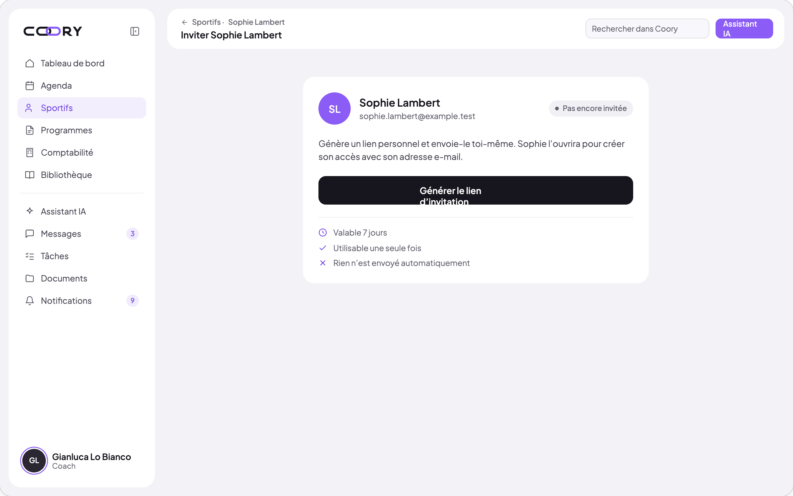

# 09 · Inviter un sportif — spécification desktop (1280 px)

## Architecture desktop
1. Shell : « Sportifs » actif ; header standard « ← Sportifs · Sophie Lambert » / « Inviter Sophie Lambert » (remplace la card titre flottante de la version actuelle).
2. Card centrée `width:560px; padding:26px; gap:20px; border-radius:20px`, `padding-top:28px` sous le header :
   - Ligne sportif : avatar 52 (couleur du sportif) · nom `600 17px` · e-mail d’accès `13px #64626e` · **pastille d’état** (`height:26px; radius:13px` + point) :
     | État | Pastille | Texte | Actions |
     |---|---|---|---|
     | 1 Pas encore invité | « Pas encore invitée » `#f1f0f5/#64626e` | « Génère un lien personnel… » | **Générer le lien d’invitation** |
     | 2 Lien généré (NOUVEAU) | « Lien prêt » `#ede6ff/#5b30d6` | « Copie le lien maintenant : … il ne sera plus affiché ensuite. » | champ lien + **Copier le lien** ; 3 raccourcis **WhatsApp · E-mail · SMS** |
     | 3 En attente | « En attente · jusqu’au 10 nov. » `#fff3d6/#9a5b0a` | « Un lien est valable jusqu’au 10 novembre 2026 à 14:32… » | **Générer un nouveau lien** + **Révoquer ce lien** (rouge) |
     | 4 Compte activé | « Compte activé » `#e3f6f1/#11867a` | « Thomas a déjà activé son compte… » | **Voir la fiche** + **Envoyer un message** |
   - Rappel en 3 points (états 1–3), séparé par un trait : ⏱ Valable 7 jours · ✓ Utilisable une seule fois · ✕ Rien n’est envoyé automatiquement.

> Valeurs non citées ici : voir `layout-measurements.md` (exactes). Shell : `../../global-shell/`.
