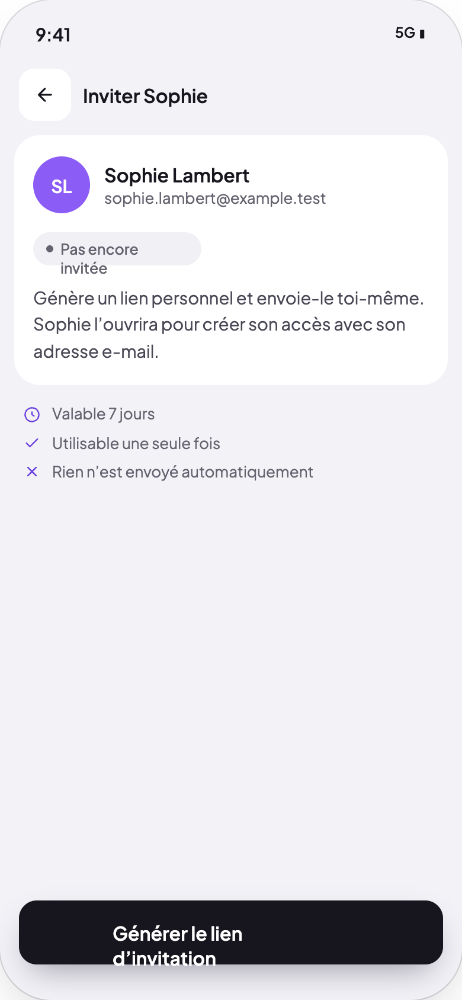
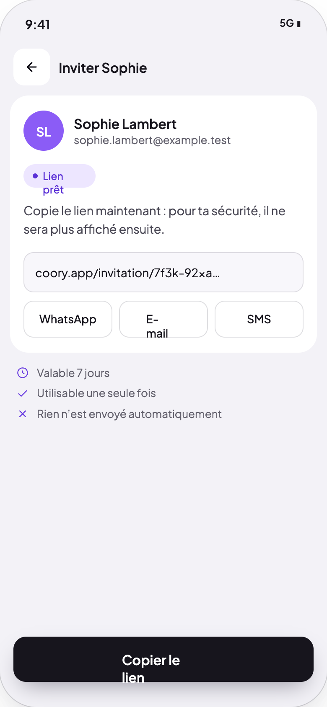
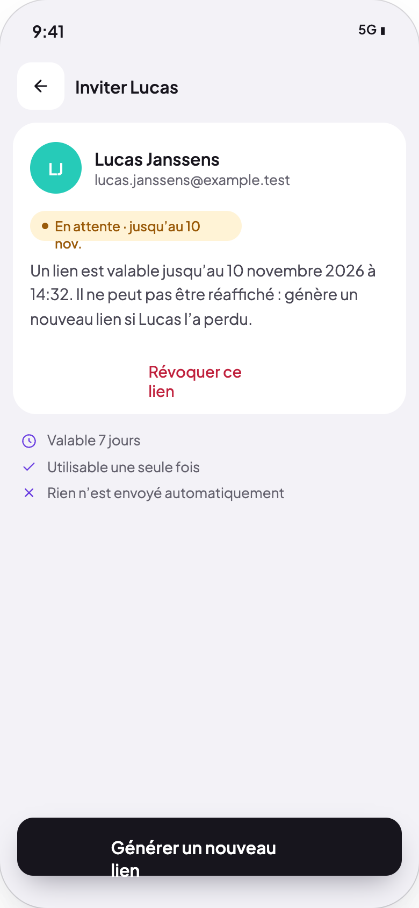
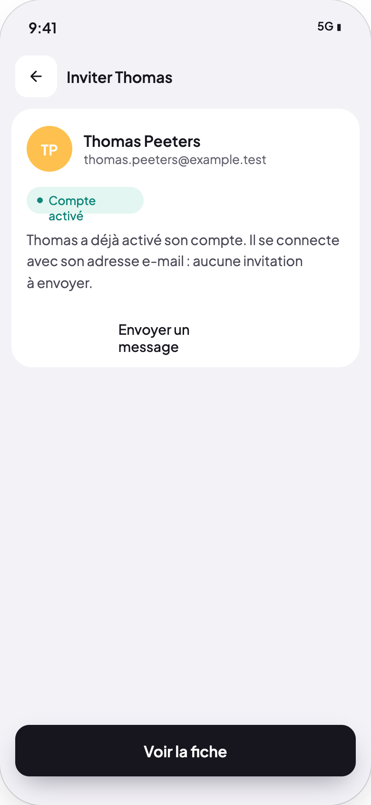

# 09 · Inviter un sportif — spécification mobile (390 px)

## Architecture mobile
- En-tête **SH-05** : ☰ · « ← Sportifs » (ou l’écran d’origine) · ✦ 🔔 (décision du 4 nov. : l’en-tête « ← Titre » de la maquette n’est pas reproduit).
- Titre de la page une seule fois en tête du contenu (« Inviter Sophie », prénom seul).
- Rappel en 3 points sous la card.
- **Barre fixe** avec l’action principale (« Générer le lien d’invitation », « Copier le lien », « Générer un nouveau lien », « Voir la fiche »).

> Barre d’état « 9:41 » éventuelle = présentation, ne pas implémenter. En-tête : appliquer `../../global-shell/mobile-layout.md` et `contextual-navigation.md`.
