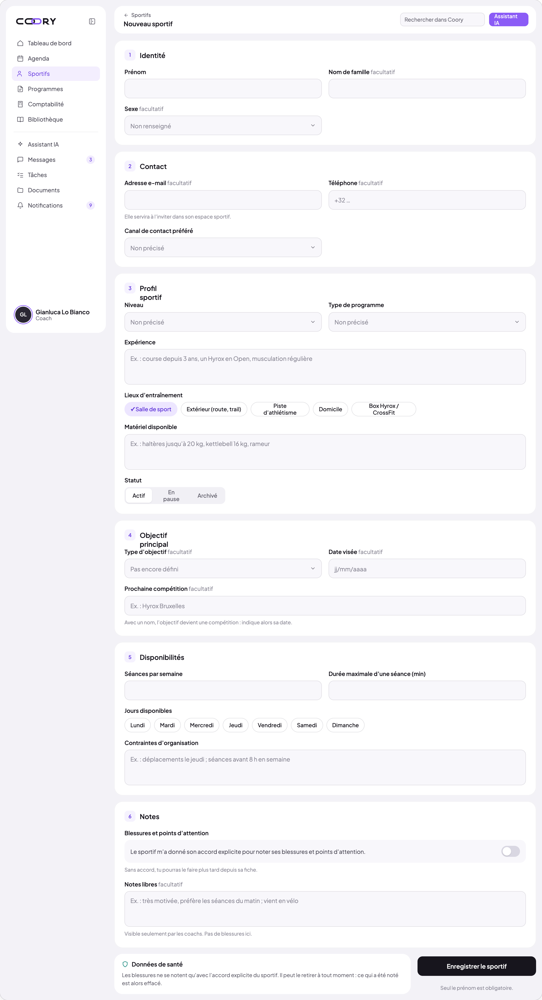

# 10 · Nouveau sportif — spécification desktop (1280 px)

## Architecture desktop — cards pleine largeur empilées
1. Shell : « Sportifs » actif ; header « ← Sportifs » / « Nouveau sportif ».
2. **6 cards numérotées** (C-SECTION) pleine largeur, `gap:14px`, grille interne `1fr 1fr; gap:16px` :
   1. **Identité** : Prénom · Nom de famille (facultatif) · Sexe ▾ (facultatif, « Non renseigné »)
   2. **Contact** : Adresse e-mail (facultatif, aide « Elle servira à l’inviter dans son espace sportif. ») · Téléphone (« +32 … ») · Canal de contact préféré ▾
   3. **Profil sportif** : Niveau ▾ · Type de programme ▾ · Expérience (zone) · **Lieux d’entraînement** (pilules multiples : Salle de sport · Extérieur (route, trail) · Piste d’athlétisme · Domicile · Box Hyrox / CrossFit) · Matériel disponible (zone) · **Statut** segmenté Actif · En pause · Archivé
   4. **Objectif principal** : Type d’objectif ▾ · Date visée · Prochaine compétition (aide « Avec un nom, l’objectif devient une compétition… »)
   5. **Disponibilités** : Séances par semaine · Durée maximale (min) · **Jours disponibles** (7 pilules) · Contraintes d’organisation
   6. **Notes** : **Blessures et points d’attention** (encadré `#f8f7fb` avec **interrupteur d’accord explicite** ; le champ blessures n’apparaît qu’une fois l’accord activé) · Notes libres (aide « Visible seulement par les coachs. Pas de blessures ici. »)
3. **Pied de page** (grille `minmax(0,1fr) 280px`) : card **Données de santé** (bouclier vert + texte) à gauche · **Enregistrer le sportif** (46 px) + « Seul le prénom est obligatoire. » à droite.
(Le sommaire de sections a été **supprimé** à la demande du propriétaire.)

> Valeurs non citées ici : voir `layout-measurements.md` (exactes). Shell : `../../global-shell/`.
