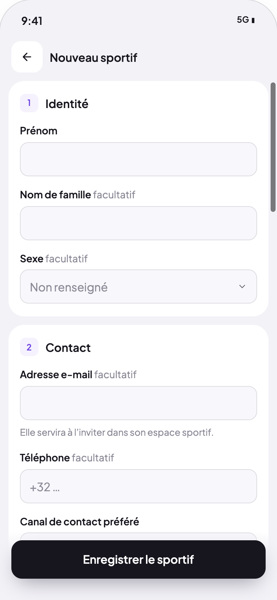

# 10 · Nouveau sportif — spécification mobile (390 px)

## Architecture mobile
- En-tête **SH-05** : ☰ · « ← Sportifs » (ou l’écran d’origine) · ✦ 🔔 (décision du 4 nov. : l’en-tête « ← Titre » de la maquette n’est pas reproduit).
- Titre de la page une seule fois en tête du contenu.
- 6 cards empilées (champs en 1 colonne, pilules 40 px, statut en 3 segments égaux, interrupteur d’accord 48×28).
- **Barre fixe** « Enregistrer le sportif ».

> Barre d’état « 9:41 » éventuelle = présentation, ne pas implémenter. En-tête : appliquer `../../global-shell/mobile-layout.md` et `contextual-navigation.md`.
