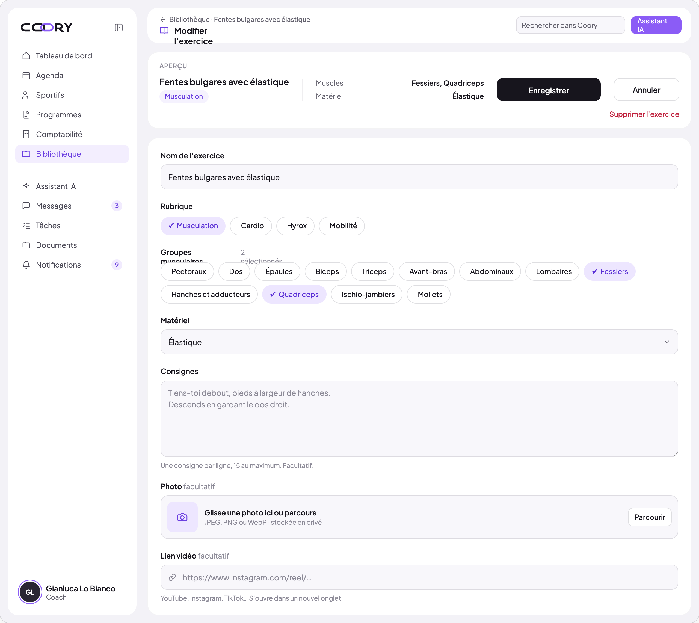

# 11 · Modifier l’exercice — spécification desktop (1280 px)

## Architecture desktop — même gabarit que 08
1. Header : « ← Bibliothèque · Fentes bulgares avec élastique » / « Modifier l’exercice ».
2. **Card APERÇU (au-dessus)** : idem 08 + bouton **Enregistrer** + Annuler + lien rouge **« Supprimer l’exercice »** (`grid-column:1/-1; text-align:right`).
3. **Card formulaire** : champs de 08 (pré-remplis : Musculation, Fessiers + Quadriceps, Élastique) puis :
   - Consignes + aide **« Une consigne par ligne, 15 au maximum. Facultatif. »**
   - **Photo** facultatif : zone F-DROP (vignette caméra 56×56 `#ede6ff`, « Glisse une photo ici ou parcours », « JPEG, PNG ou WebP · stockée en privé », bouton « Parcourir »). Une fois ajoutée : vignette + « Remplacer » / « Retirer » (PROPOSED, non dessiné).
   - **Lien vidéo** facultatif : champ avec icône lien, placeholder « https://www.instagram.com/reel/… », aide « YouTube, Instagram, TikTok… S’ouvre dans un nouvel onglet. »

> Valeurs non citées ici : voir `layout-measurements.md` (exactes). Shell : `../../global-shell/`.
