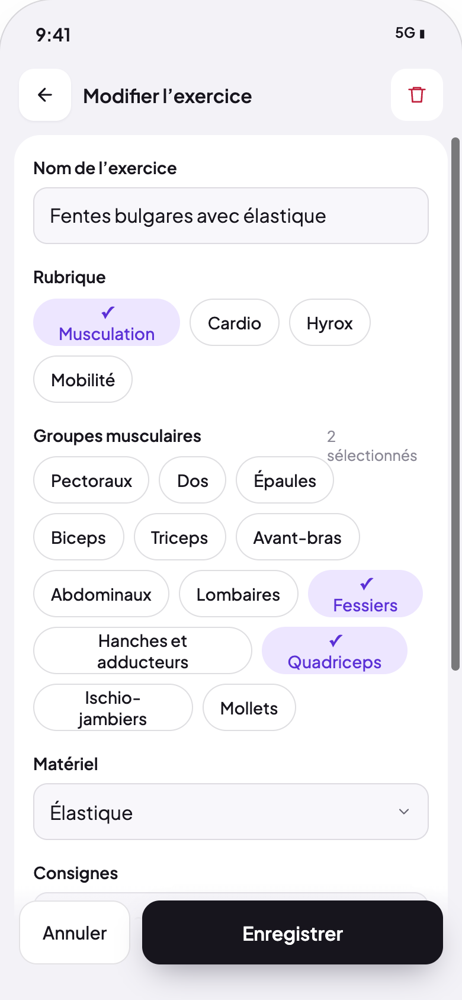

# 11 · Modifier l’exercice — spécification mobile (390 px)

## Architecture mobile
- En-tête **SH-05** : ☰ · « ← Bibliothèque » (ou l’écran d’origine) · ✦ 🔔 (décision du 4 nov. : l’en-tête « ← Titre » de la maquette n’est pas reproduit).
- Titre de la page une seule fois en tête du contenu, corbeille rouge 44×44 à sa droite.
- Card formulaire (Photo : « Ajouter une photo » + Parcourir 40 px ; Lien vidéo 48 px).
- Barre fixe Annuler / Enregistrer.

> Barre d’état « 9:41 » éventuelle = présentation, ne pas implémenter. En-tête : appliquer `../../global-shell/mobile-layout.md` et `contextual-navigation.md`.
