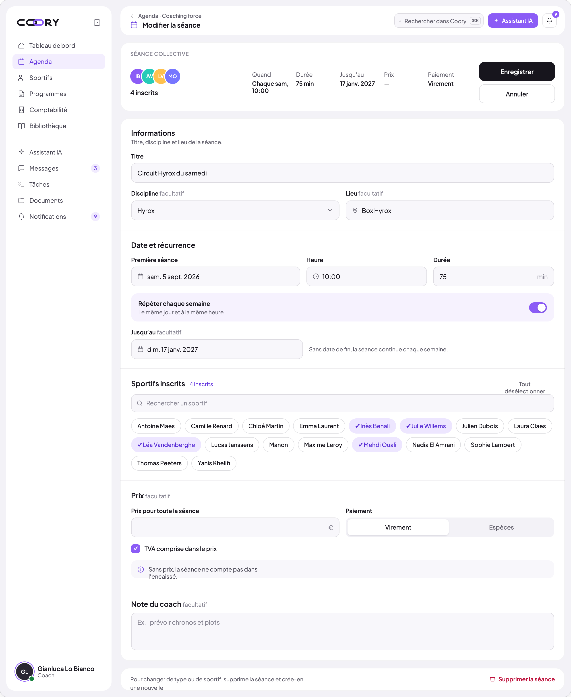

# 12 · Modifier la séance — individuelle et collective — spécification desktop (1280 px)

## Architecture desktop — gabarit 06 + ajouts
1. Header « ← Circuit Hyrox du samedi » / « Modifier la séance ».
2. **C-RECAP (au-dessus)** : libellé « SÉANCE COLLECTIVE » ou « SÉANCE INDIVIDUELLE » ; individuelle → avatar + « Yanis Khelifi » + « Voir la fiche » ; collective → **pile d’avatars** des inscrits (34 px, chevauchement −8 px, anneau blanc 2 px, 6 max) + « 4 inscrits » ; récap 5 colonnes ; Enregistrer / Annuler.
3. **C-FORM** : Informations · Date et récurrence (idem 06) · **Sportifs inscrits** (collective uniquement) : titre + compteur violet « N inscrits » + « Tout désélectionner » ; recherche « Rechercher un sportif » ; pilules multiples de tous les sportifs · **Prix** : « Prix pour toute la séance » (collective) / « Prix de la séance » ; ligne de calcul collective : « X € TTC pour la séance, soit Y € par inscrit. » ; sans prix : « Sans prix, la séance ne compte pas dans l’encaissé. » · **Note du coach** (facultatif, « Ex. : prévoir chronos et plots »).
4. **C-FOOT** : avertissement + « Supprimer la séance ».
Données des captures du propriétaire : collective = Circuit Hyrox du samedi · Hyrox · Box Hyrox · 09/05/2026 10:00 · 75 min · TVA comprise ; individuelle = Coaching force · Yanis Khelifi · Musculation · Salle de sport · 09/07/2026 08:15 · 60 min · jusqu’au 01/17/2027 · 65 € · TVA non comprise.

> Valeurs non citées ici : voir `layout-measurements.md` (exactes). Shell : `../../global-shell/`.
