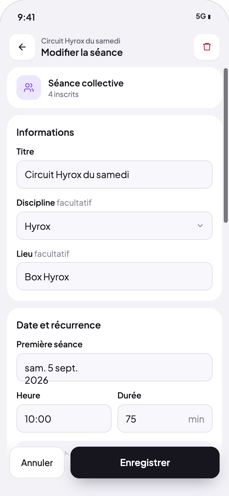
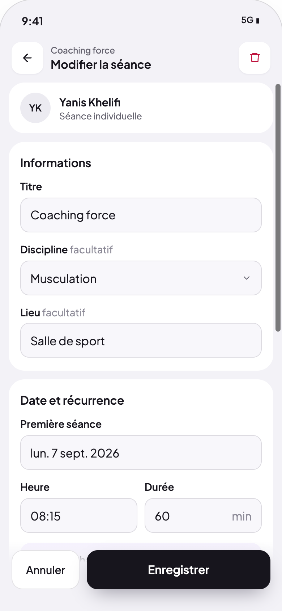

# 12 · Modifier la séance — individuelle et collective — spécification mobile (390 px)

## Architecture mobile
- En-tête **SH-05** : ☰ · « ← Agenda » (ou l’écran d’origine) · ✦ 🔔.
- Titre de la séance en tête du contenu + corbeille rouge à sa droite.
- Card « qui » (avatar sportif, ou icône groupe violette + « N inscrits ») · Informations · Date et récurrence · **Sportifs inscrits** (collective, pilules 40 px) · Prix · Note du coach · avertissement.
- Barre fixe Annuler / Enregistrer.

> Barre d’état « 9:41 » éventuelle = présentation, ne pas implémenter. En-tête : appliquer `../../global-shell/mobile-layout.md` et `contextual-navigation.md`.
