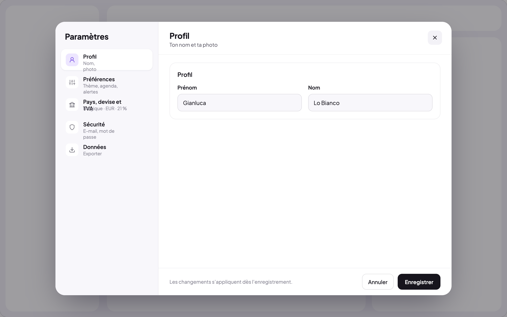

# 13 · Paramètres — spécification desktop (1280 px)

## Architecture desktop — M-DIALOG 1000×690 (fenêtre par-dessus la page, pas de route — validé)
- Overlay `rgba(23,21,29,.42)` sur la page (shell visible).
- **Menu gauche** `width:260px; background:#f8f7fb; padding:24px 14px` : titre « Paramètres » `700 20px` ; 5 boutons `padding:10px 12px; radius:12px` = icône 32×32 (fond `#ede6ff`/`#6a3ee0` si actif, sinon blanc/`#64626e`) + libellé `600 13.5px` + **sous-titre** `400 11.5px #8b8996` (« Nom, photo », « Thème, agenda, alertes », « Belgique · EUR · 21 % », « E-mail, mot de passe », « Exporter ») ; actif = fond blanc + ombre.
- **Contenu** : en-tête fixe (titre `700 20px` + sous-titre + **Fermer** 36×36 `#f3f2f7`) ; zone défilante `padding:20px 28px 24px; gap:14px` de cards C-SETTINGS ; **pied fixe** (Profil, Préférences, TVA) : « Les changements s’appliquent dès l’enregistrement. » · Annuler · **Enregistrer** (un seul bouton par rubrique, remplace les boutons noirs dans chaque card).
### Rubriques
| Rubrique | Cards |
|---|---|
| Profil | 🔒 **Hors périmètre : déjà fait dans l’app, ne pas toucher.** Seule son entrée dans le menu de rubriques doit adopter le style des autres. |
| Préférences | **Thème** segmenté Clair · Sombre · Système · **Valeurs par défaut** (Durée « 60 min », Lieu, Prix « € » + aide TVA, Paiement Virement · Espèces) · **Heures de l’agenda** (À partir de 06:00 ▾ · Jusqu’à 22:00 ▾) · **Notifications** : 5 interrupteurs (Messages non lus · Tâches du jour et en retard · Séances à encaisser · Compétitions dans les 7 jours · Fiches à compléter) |
| Pays, devise et TVA | **Pays et devise** (Pays ▾ Belgique · Devise « Euro (EUR) » en texte + « ⇄ Changer de devise ») · **TVA** (interrupteur « Je facture la TVA » ; **Taux de TVA « 21 % » visible seulement si activé**) |
| Sécurité | Adresse e-mail (actuelle + nouvelle + « Changer d’adresse ») · Mot de passe (actuel avec « Afficher », nouveau ≥ 10 caractères, confirmation, « Changer le mot de passe ») · Appareils connectés (**« Déconnecter partout » rouge** + « Se déconnecter ») |
| Données | Exporter mes données (« ↓ Télécharger mes données » + avertissement données de santé sur fond `#fff8ea`) |

> Valeurs non citées ici : voir `layout-measurements.md` (exactes). Shell : `../../global-shell/`.
