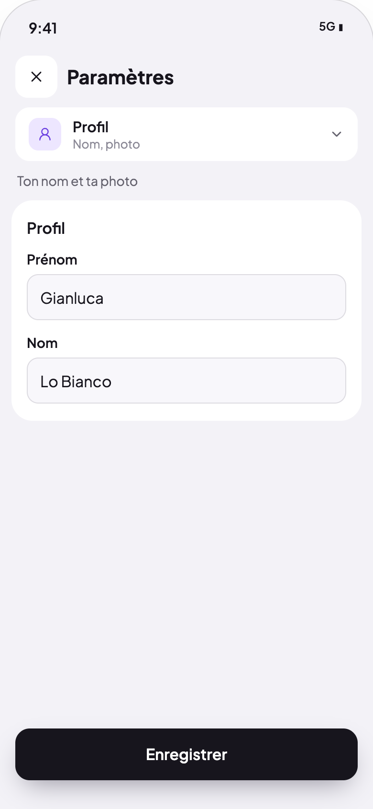
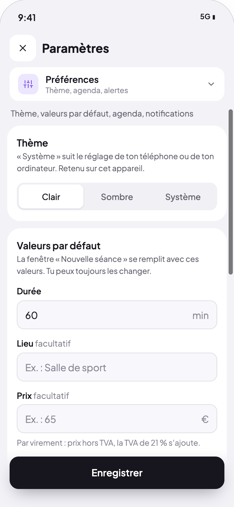
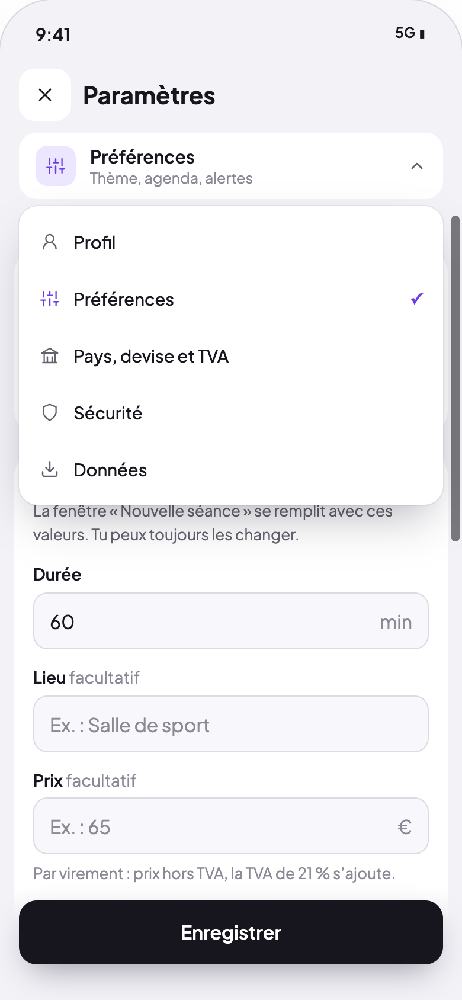
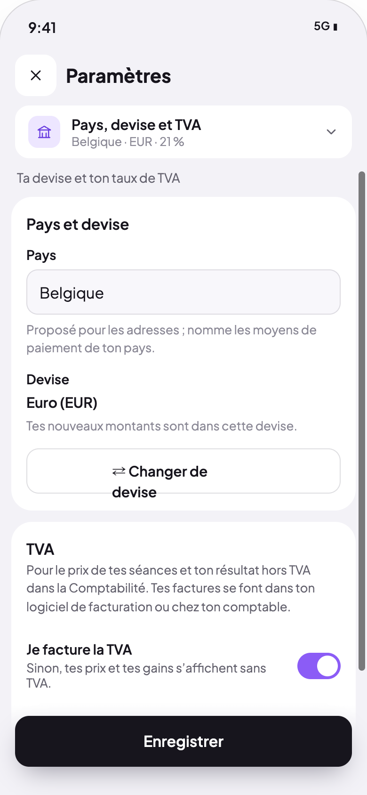
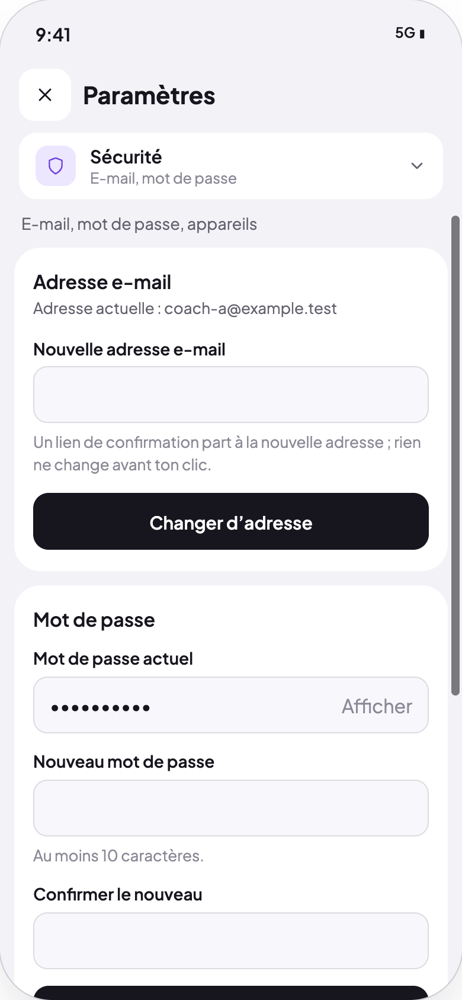
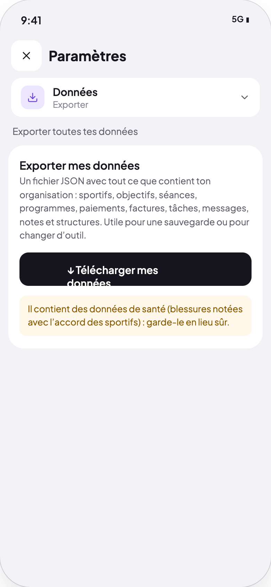

# 13 · Paramètres — spécification mobile (390 px)

## Architecture mobile — fenêtre plein écran par-dessus la page (EX-04, pas de route — validé)
> 🔒 Rubrique **Profil** : ne pas modifier (déjà faite).
- En-tête : **Fermer (×)** 44×44 + « Paramètres » `700 20px`.
- **Menu déroulant de rubrique** (validé 4 nov. 2026, remplace les onglets défilants) : bouton pleine largeur `height:56px; radius:15px; #fff` = icône 34×34 `#ede6ff` + rubrique `600 15px` + sous-titre `12.5px #8b8996` + chevron (pivote à l’ouverture) ; menu M-MENU sous le bouton (items 48 px, icône, libellé, **✓ violet** sur l’actif).
- Sous-titre de rubrique puis cards C-MOBILE (champs 48 px, segments égaux 46 px, interrupteurs 46×28, boutons pleine largeur 48 px).
- **Barre fixe « Enregistrer »** pour Préférences / TVA (Profil : comportement existant).

> Barre d’état « 9:41 » éventuelle = présentation, ne pas implémenter. Fenêtre : fermeture par × (pas de retour fléché).
