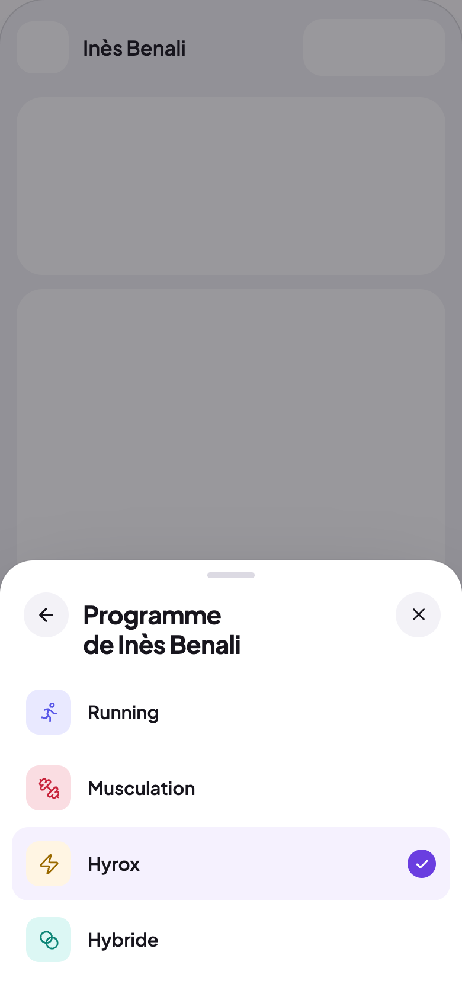

# 08 — Programme d’un sportif · Mobile

Capture : 

Toutes les valeurs ci-dessous sont **exactes** : extraites du fichier source `Coory Boites.dc.html` (styles inline). Les largeurs de colonnes marquées « ≈ » sont calculées.

## Géométrie

| Propriété | Valeur | Statut |
|---|---|---|
| Cadre de référence | 390px × 844px | exact (source) |
| Type | bottom sheet | exact |
| Position | feuille du bas : left 0, right 0, bottom 0 | exact |
| Largeur | 100 % du viewport (390 px) | exact |
| Hauteur | selon contenu · max calc(100% - 44px) | exact |
| Rayon | 28px 28px 0 0 | exact |
| Fond | #ffffff | exact |
| Ombre | 0 30px 80px -20px rgba(23,21,29,.45), 0 0 0 1px rgba(23,21,29,.05) | exact |
| Overlay | rgba(23,21,29,.44) plein écran | exact |
| Poignée | 40 × 5 px, rayon 5, #dcdae3, padding 10 px 0 2 px | exact |
| En-tête | padding 10px 18px 10px 20px · titre 21px/1.2 700 · sous-titre 14/1.5 400 #64626e · fermer 38 px | exact |
| Liste | padding 4px 10px 20px · ligne min-height 62px · padding 8 px 12 px · rayon 14 · gap 2 px | exact |
| Tuile d’icône | 38 × 38, rayon 11, icône 19 px trait 1.8 | exact |
| Libellé / description | 15.5 px 600 / 13 px 400 #64626e | exact |

## Contenu (haut → bas)

| # | Élément | Texte | Icône (Lucide) | État |
|---|---|---|---|---|
| 1 | Action | Running | PERSONNALISÉ (silhouette course, svg fourni) · tuile color-mix(in srgb, #7776FF 16%, #fff) · icône #5a58e8 | — |
| 2 | Action | Musculation | dumbbell · tuile color-mix(in srgb, #DD2D4A 16%, #fff) · icône #c8243c | — |
| 3 | Action | Hyrox | zap · tuile color-mix(in srgb, #FEC14F 16%, #fff) · icône #9a6a00 | sélectionné (fond #f5f1fe + coche violette) |
| 4 | Action | Hybride | PERSONNALISÉ (deux cercles, svg fourni) · tuile color-mix(in srgb, #26CBB8 16%, #fff) · icône #0d8576 | — |
