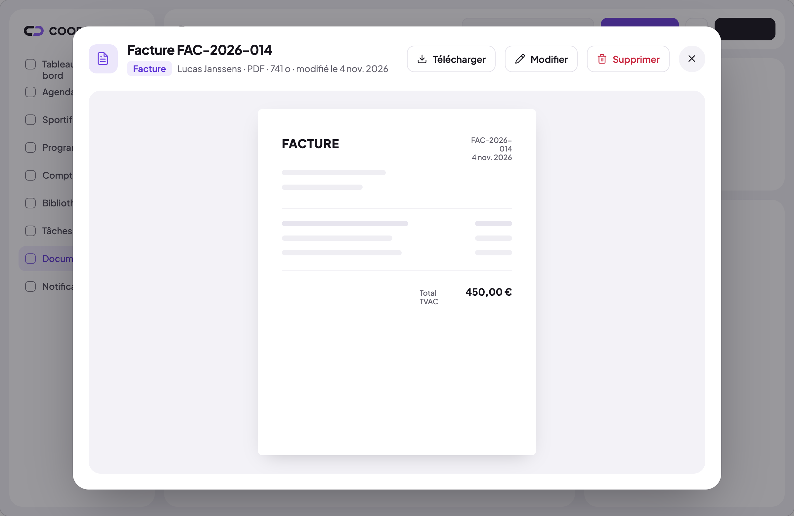

# 23 — Aperçu d’un document · Desktop

Capture : 

Toutes les valeurs ci-dessous sont **exactes** : extraites du fichier source `Coory Boites.dc.html` (styles inline). Les largeurs de colonnes marquées « ≈ » sont calculées.

## Géométrie

| Propriété | Valeur | Statut |
|---|---|---|
| Cadre de référence | 1200px × 780px | exact (source) |
| Type | fenêtre modale centrée | exact |
| Position | centré : left 50 %, top 50 %, translate(-50 %, -50 %) | exact |
| Largeur | 980px | exact |
| Hauteur | 700px · max none | exact |
| Rayon | 24px | exact |
| Fond | #ffffff | exact |
| Ombre | 0 30px 80px -20px rgba(23,21,29,.45), 0 0 0 1px rgba(23,21,29,.05) | exact |
| Overlay | rgba(23,21,29,.44) plein écran | exact |
| En-tête | aucun | exact |

## Contenu (haut → bas)

En-tête : tuile fichier 44 px violette, titre « Facture FAC-2026-014 » 20 px 700, ligne méta (pastille « Facture » #f1edfd/#5b31d6 + « Lucas Janssens · PDF · 741 o · modifié le 4 nov. 2026 »), 3 boutons contour 40 px (Télécharger, Modifier, Supprimer en rouge), fermer 40 px.

Aperçu : zone #f3f2f7 rayon 18, marge 0 24 24, padding 28 ; page blanche 420 px de large, rayon 6, ombre 0 10 30 -12 rgba(23,21,29,.25), contenu = rendu réel du PDF (dans la maquette : barres grises de substitution).
