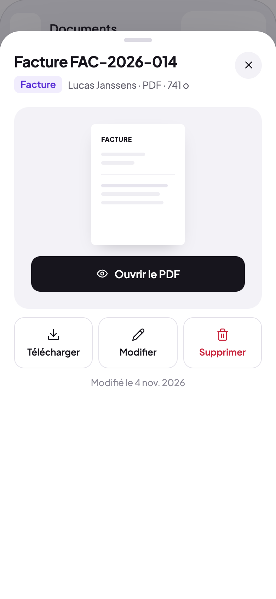

# 23 — Aperçu d’un document · Mobile

Capture : 

Toutes les valeurs ci-dessous sont **exactes** : extraites du fichier source `Coory Boites.dc.html` (styles inline). Les largeurs de colonnes marquées « ≈ » sont calculées.

## Géométrie

| Propriété | Valeur | Statut |
|---|---|---|
| Cadre de référence | 390px × 844px | exact (source) |
| Type | bottom sheet | exact |
| Position | feuille du bas : left 0, right 0, bottom 0 | exact |
| Largeur | 100 % du viewport (390 px) | exact |
| Hauteur | calc(100% - 44px) · max calc(100% - 44px) | exact |
| Rayon | 28px 28px 0 0 | exact |
| Fond | #ffffff | exact |
| Ombre | 0 30px 80px -20px rgba(23,21,29,.45), 0 0 0 1px rgba(23,21,29,.05) | exact |
| Overlay | rgba(23,21,29,.44) plein écran | exact |
| Poignée | 40 × 5 px, rayon 5, #dcdae3, padding 10 px 0 2 px | exact |
| En-tête | aucun | exact |

## Contenu (haut → bas)

En-tête : titre 21 px 700 + méta (pastille Facture + « Lucas Janssens · PDF · 741 o ») + fermer.

Carte aperçu #f3f2f7 rayon 20 padding 24 : vignette 132 × 170 + bouton noir « Ouvrir le PDF » 50 px pleine largeur.

Actions : grille 3 colonnes gap 8, tuiles 72 px de haut rayon 14 (Télécharger, Modifier, Supprimer rouge). Mention « Modifié le 4 nov. 2026 » 13 px #8b8996 centrée.
