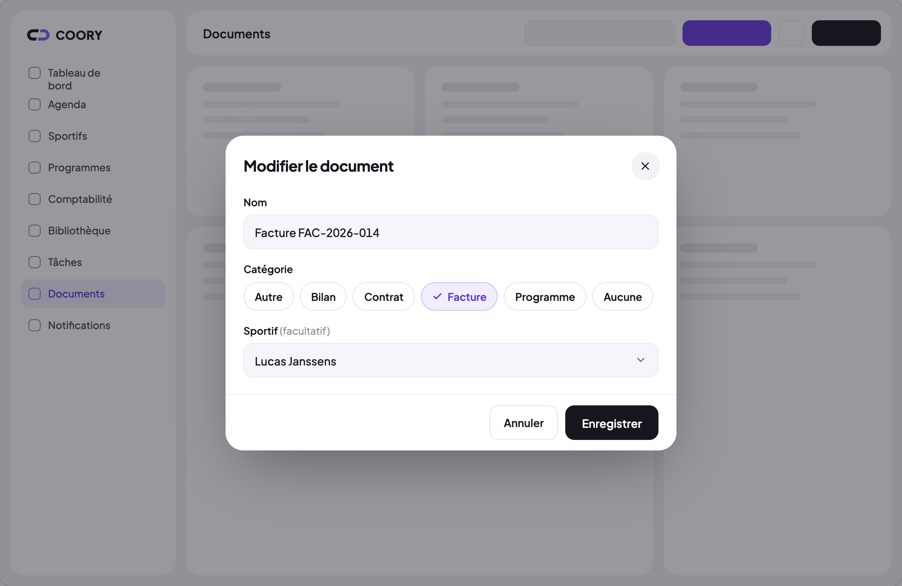

# 24 — Modifier le document · Desktop

Capture : 

Toutes les valeurs ci-dessous sont **exactes** : extraites du fichier source `Coory Boites.dc.html` (styles inline). Les largeurs de colonnes marquées « ≈ » sont calculées.

## Géométrie

| Propriété | Valeur | Statut |
|---|---|---|
| Cadre de référence | 1200px × 780px | exact (source) |
| Type | fenêtre modale centrée | exact |
| Position | centré : left 50 %, top 50 %, translate(-50 %, -50 %) | exact |
| Largeur | 600px | exact |
| Hauteur | selon contenu · max 720px | exact |
| Rayon | 24px | exact |
| Fond | #ffffff | exact |
| Ombre | 0 30px 80px -20px rgba(23,21,29,.45), 0 0 0 1px rgba(23,21,29,.05) | exact |
| Overlay | rgba(23,21,29,.44) plein écran | exact |
| En-tête | padding 22px 22px 10px 24px · titre 20px/1.2 700 · sous-titre 14/1.5 400 #64626e · fermer 38 px | exact |
| Corps | padding 10px 24px 22px · grille 12 colonnes · gap 18 px (lignes) 14 px (colonnes) · défilant | exact |
| Champs | hauteur 46px · rayon 12 · fond #f6f5f9 · bordure 1 px #ebe9f0 · texte 15 px | exact |
| Pied | padding 14px 24px · bordure haute 1 px #efeef3 · fixe (hors zone défilante) | exact |
| Bouton principal | hauteur 46px · rayon 12 · #17151d · texte blanc 15 px 600 | exact |

## Contenu (haut → bas)

| # | Champ | Type | Facultatif | Largeur | Contenu |
|---|---|---|---|---|---|
| 1 | Nom | texte | non | 12/12 col ≈ 552 px | valeur « Facture FAC-2026-014 » |
| 2 | Catégorie | pastilles (choix unique) | non | 12/12 col ≈ 552 px | options : Autre / Bilan / Contrat / Facture (sélectionné) / Programme / Aucune |
| 3 | Sportif | select | oui | 12/12 col ≈ 552 px | valeur « Lucas Janssens » |

Pied : « Annuler » (bordure 1 px #e4e2ea, 46 px) · « Enregistrer ».
