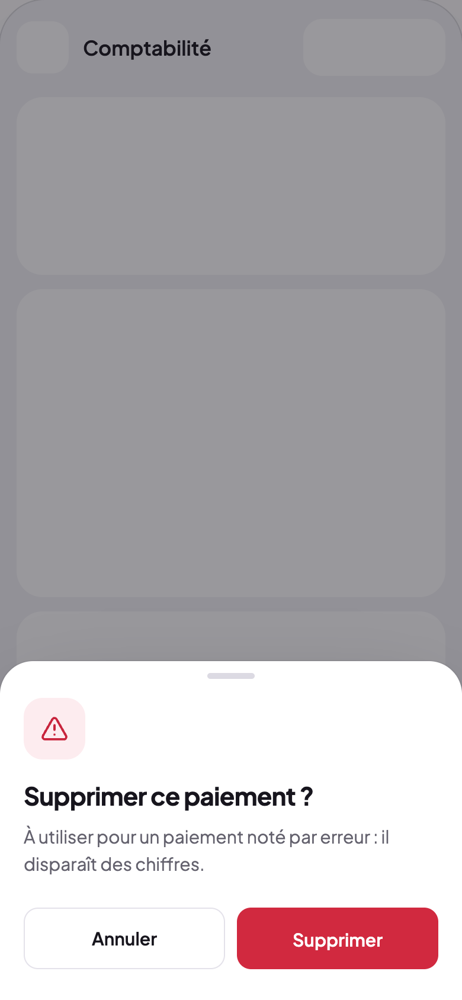

# 31 — Supprimer ce paiement ? · Mobile

Capture : 

Toutes les valeurs ci-dessous sont **exactes** : extraites du fichier source `Coory Boites.dc.html` (styles inline). Les largeurs de colonnes marquées « ≈ » sont calculées.

## Géométrie

| Propriété | Valeur | Statut |
|---|---|---|
| Cadre de référence | 390px × 844px | exact (source) |
| Type | bottom sheet | exact |
| Position | feuille du bas : left 0, right 0, bottom 0 | exact |
| Largeur | 100 % du viewport (390 px) | exact |
| Hauteur | selon contenu · max calc(100% - 44px) | exact |
| Rayon | 28px 28px 0 0 | exact |
| Fond | #ffffff | exact |
| Ombre | 0 30px 80px -20px rgba(23,21,29,.45), 0 0 0 1px rgba(23,21,29,.05) | exact |
| Overlay | rgba(23,21,29,.44) plein écran | exact |
| Poignée | 40 × 5 px, rayon 5, #dcdae3, padding 10 px 0 2 px | exact |
| En-tête | aucun | exact |
| Corps | padding 14px 20px 26px | exact |
| Icône | tuile 52 × 52 rayon 16 #fdecef, icône 24 px #c8243c | exact |
| Titre / texte | 21/1.25 700 (marge haute 18) / 15/1.55 #64626e (marge 8) | exact |
| Boutons | grille 2 colonnes gap 10, marge haute 26, hauteur 52px, rayon 12 | exact |

## Contenu (haut → bas)

Icône : triangle-alert

Titre : « Supprimer ce paiement ? »

Texte : À utiliser pour un paiement noté par erreur : il disparaît des chiffres.

Boutons : « Annuler » (blanc, bordure #e4e2ea) · « Supprimer » (#d1293f, texte blanc).
