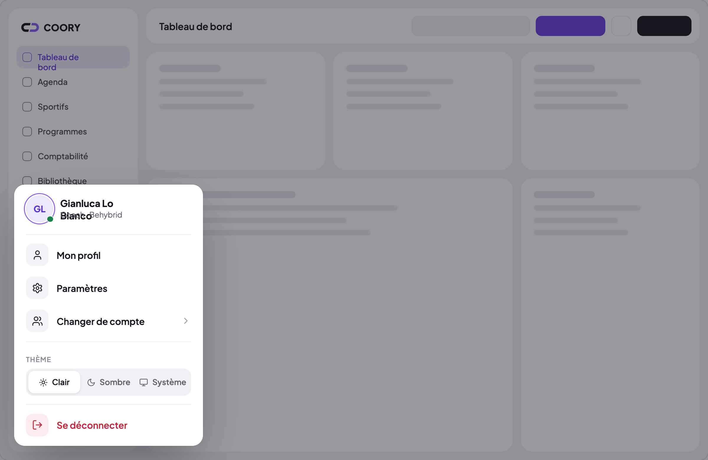

# 32 — Menu du compte · Desktop

Capture : 

Toutes les valeurs ci-dessous sont **exactes** : extraites du fichier source `Coory Boites.dc.html` (styles inline). Les largeurs de colonnes marquées « ≈ » sont calculées.

## Géométrie

| Propriété | Valeur | Statut |
|---|---|---|
| Cadre de référence | 1200px × 780px | exact (source) |
| Type | menu ancré (popover) | exact |
| Position | ancré : left 24px, top auto, bottom 24px (dans un cadre 1200×780 ; à ancrer au bouton déclencheur) | exact |
| Largeur | 320px | exact |
| Hauteur | selon contenu · max 720px | exact |
| Rayon | 18px | exact |
| Fond | #ffffff | exact |
| Ombre | 0 30px 80px -20px rgba(23,21,29,.45), 0 0 0 1px rgba(23,21,29,.05) | exact |
| Overlay | rgba(23,21,29,.44) plein écran | exact |
| En-tête | aucun | exact |
| Liste | padding 8px · ligne min-height 50px · padding 8 px 12 px · rayon 14 · gap 2 px | exact |
| Tuile d’icône | 38 × 38, rayon 11, icône 19 px trait 1.8 | exact |
| Libellé / description | 15.5 px 600 / 13 px 400 #64626e | exact |

## Contenu (haut → bas)

| # | Élément | Texte | Icône (Lucide) | État |
|---|---|---|---|---|
| 1 | Profil | Gianluca Lo Bianco · Coach · Behybrid · initiales GL | avatar 46 px | — |
| 2 | Séparateur | 1 px #efeef3, marge 6 px 12 px | — | — |
| 3 | Action | Mon profil | user · tuile #f3f2f7 · icône #17151d | — |
| 4 | Action | Paramètres | settings · tuile #f3f2f7 · icône #17151d | — |
| 5 | Action | Changer de compte | users · tuile #f3f2f7 · icône #17151d | chevron → sous-boîte |
| 6 | Séparateur | 1 px #efeef3, marge 6 px 12 px | — | — |
| 7 | Titre de section | « THÈME » | — | — |
| 8 | Segmenté 3 options | Clair (actif) / Sombre / Système | sun, moon, monitor | — |
| 9 | Séparateur | 1 px #efeef3, marge 6 px 12 px | — | — |
| 10 | Action | Se déconnecter | log-out · tuile #fdecef · icône #c8243c | destructif (rouge) |
