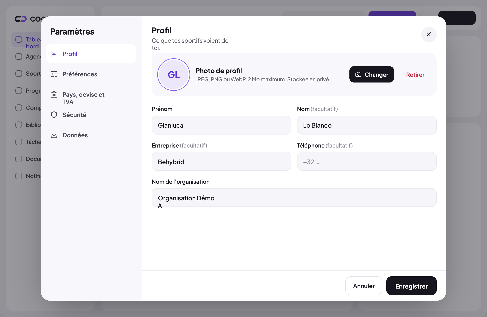

# 33 — Paramètres · Desktop

Capture : 

Toutes les valeurs ci-dessous sont **exactes** : extraites du fichier source `Coory Boites.dc.html` (styles inline). Les largeurs de colonnes marquées « ≈ » sont calculées.

## Géométrie

| Propriété | Valeur | Statut |
|---|---|---|
| Cadre de référence | 1200px × 780px | exact (source) |
| Type | fenêtre modale centrée | exact |
| Position | centré : left 50 %, top 50 %, translate(-50 %, -50 %) | exact |
| Largeur | 1000px | exact |
| Hauteur | 700px · max none | exact |
| Rayon | 24px | exact |
| Fond | #ffffff | exact |
| Ombre | 0 30px 80px -20px rgba(23,21,29,.45), 0 0 0 1px rgba(23,21,29,.05) | exact |
| Overlay | rgba(23,21,29,.44) plein écran | exact |
| En-tête | aucun | exact |

## Contenu (haut → bas)

Grille 250 px | 1fr. Colonne gauche #f8f7fb, bordure droite #efeef3, padding 24 14 : titre « Paramètres » 20 px 700, 5 lignes 46 px rayon 12 (Profil actif fond blanc texte #5b31d6 ; Préférences ; Pays, devise et TVA ; Sécurité ; Données).

Colonne droite : en-tête « Profil » 19 px + « Ce que tes sportifs voient de toi. » + fermer ; carte photo #f8f7fb rayon 18 (avatar 72 px anneau violet, texte, bouton noir « Changer » 40 px, lien rouge « Retirer ») ; grille 2 colonnes : Prénom, Nom (facultatif), Entreprise (facultatif), Téléphone (facultatif), Nom de l’organisation (pleine largeur) ; pied fixe Annuler / Enregistrer.
