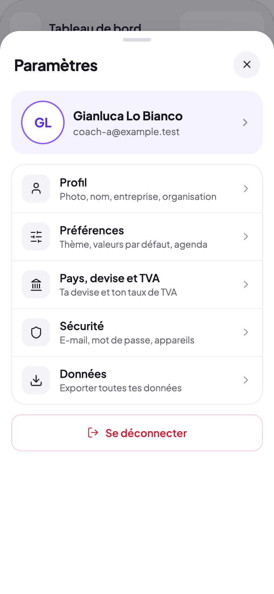

# 33 — Paramètres · Mobile

Capture : 

Toutes les valeurs ci-dessous sont **exactes** : extraites du fichier source `Coory Boites.dc.html` (styles inline). Les largeurs de colonnes marquées « ≈ » sont calculées.

## Géométrie

| Propriété | Valeur | Statut |
|---|---|---|
| Cadre de référence | 390px × 844px | exact (source) |
| Type | bottom sheet | exact |
| Position | feuille du bas : left 0, right 0, bottom 0 | exact |
| Largeur | 100 % du viewport (390 px) | exact |
| Hauteur | calc(100% - 44px) · max calc(100% - 44px) | exact |
| Rayon | 28px 28px 0 0 | exact |
| Fond | #ffffff | exact |
| Ombre | 0 30px 80px -20px rgba(23,21,29,.45), 0 0 0 1px rgba(23,21,29,.05) | exact |
| Overlay | rgba(23,21,29,.44) plein écran | exact |
| Poignée | 40 × 5 px, rayon 5, #dcdae3, padding 10 px 0 2 px | exact |
| En-tête | aucun | exact |

## Contenu (haut → bas)

Titre « Paramètres » 22 px + fermer. Carte profil #f5f1fe rayon 20 (avatar 58 px, nom 17 px 700, e-mail, chevron). Liste bordée rayon 20 : 5 lignes ≥ 68 px (tuile 40 px #f3f2f7, titre 15.5 px 600, description 13 px tronquée, chevron). Bouton « Se déconnecter » 52 px, bordure #f3cdd3, texte rouge.
