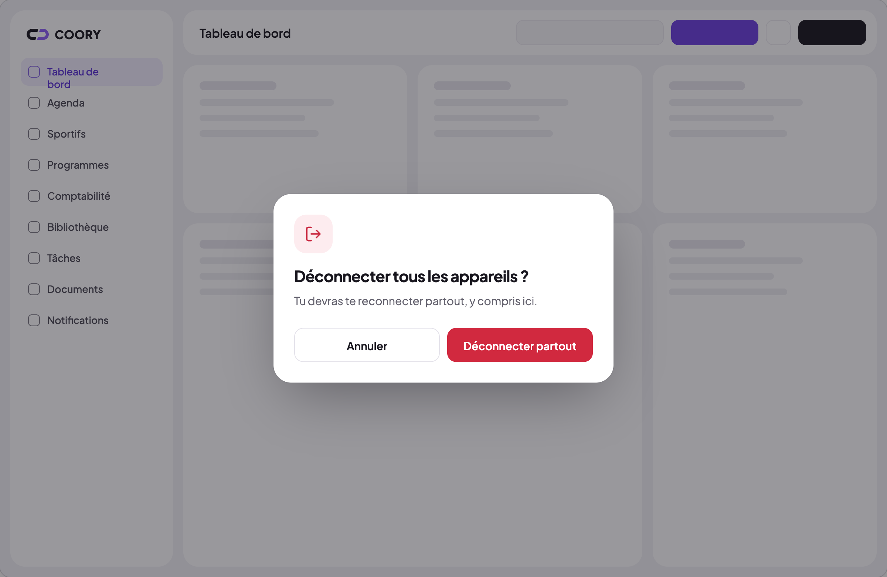

# 35 — Déconnecter tous les appareils ? · Desktop

Capture : 

Toutes les valeurs ci-dessous sont **exactes** : extraites du fichier source `Coory Boites.dc.html` (styles inline). Les largeurs de colonnes marquées « ≈ » sont calculées.

## Géométrie

| Propriété | Valeur | Statut |
|---|---|---|
| Cadre de référence | 1200px × 780px | exact (source) |
| Type | fenêtre modale centrée | exact |
| Position | centré : left 50 %, top 50 %, translate(-50 %, -50 %) | exact |
| Largeur | 460px | exact |
| Hauteur | selon contenu · max 720px | exact |
| Rayon | 24px | exact |
| Fond | #ffffff | exact |
| Ombre | 0 30px 80px -20px rgba(23,21,29,.45), 0 0 0 1px rgba(23,21,29,.05) | exact |
| Overlay | rgba(23,21,29,.44) plein écran | exact |
| En-tête | aucun | exact |
| Corps | padding 28px | exact |
| Icône | tuile 52 × 52 rayon 16 #fdecef, icône 24 px #c8243c | exact |
| Titre / texte | 21/1.25 700 (marge haute 18) / 15/1.55 #64626e (marge 8) | exact |
| Boutons | grille 2 colonnes gap 10, marge haute 26, hauteur 46px, rayon 12 | exact |

## Contenu (haut → bas)

Icône : log-out

Titre : « Déconnecter tous les appareils ? »

Texte : Tu devras te reconnecter partout, y compris ici.

Boutons : « Annuler » (blanc, bordure #e4e2ea) · « Déconnecter partout » (#d1293f, texte blanc).
